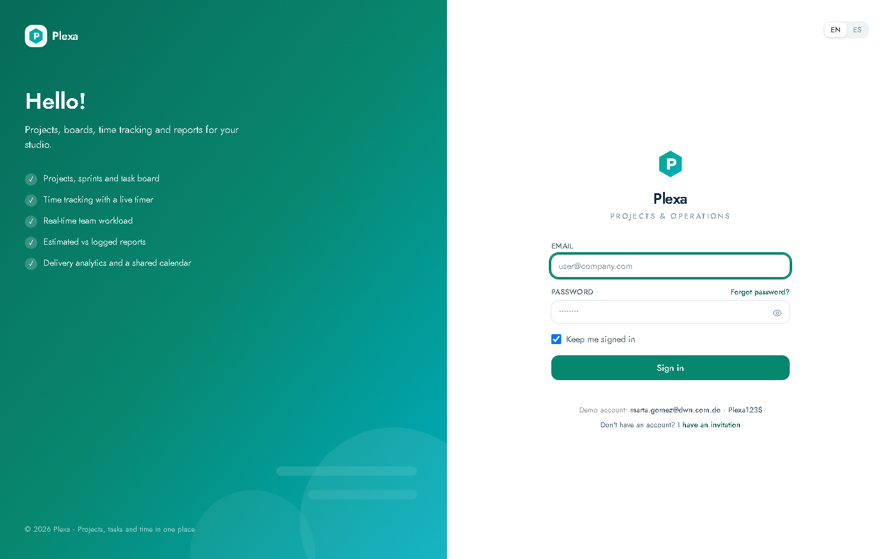
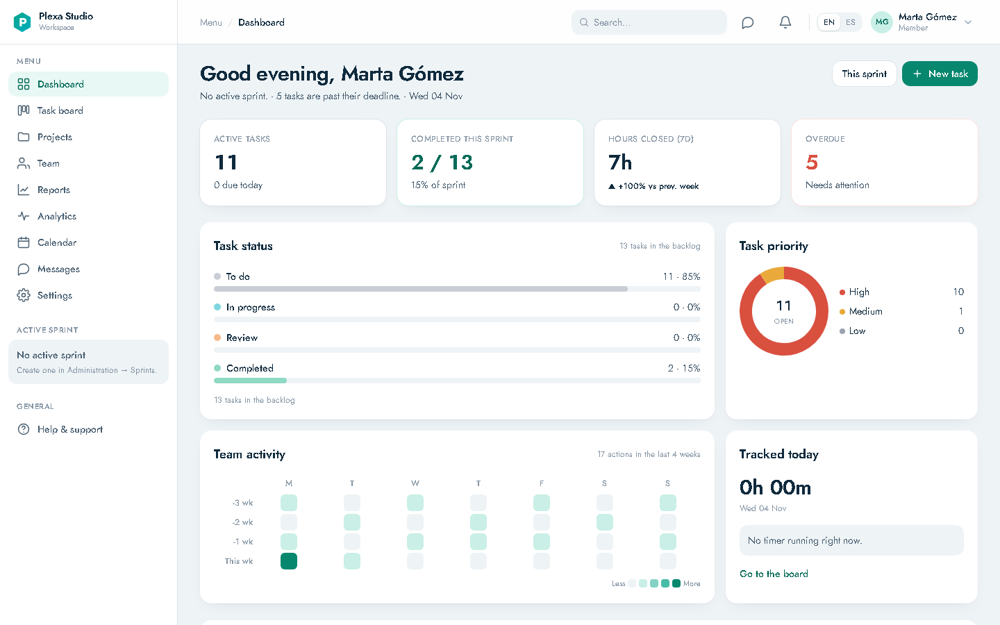
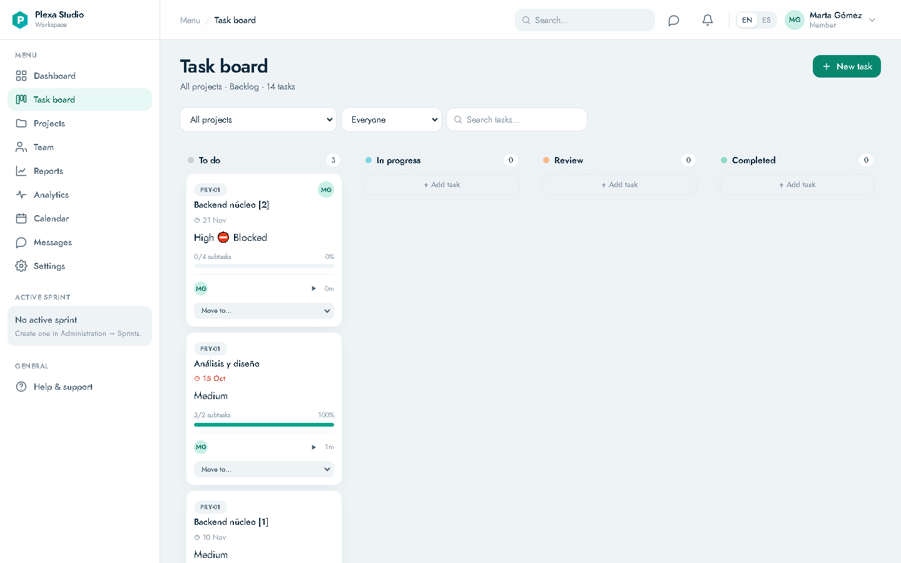
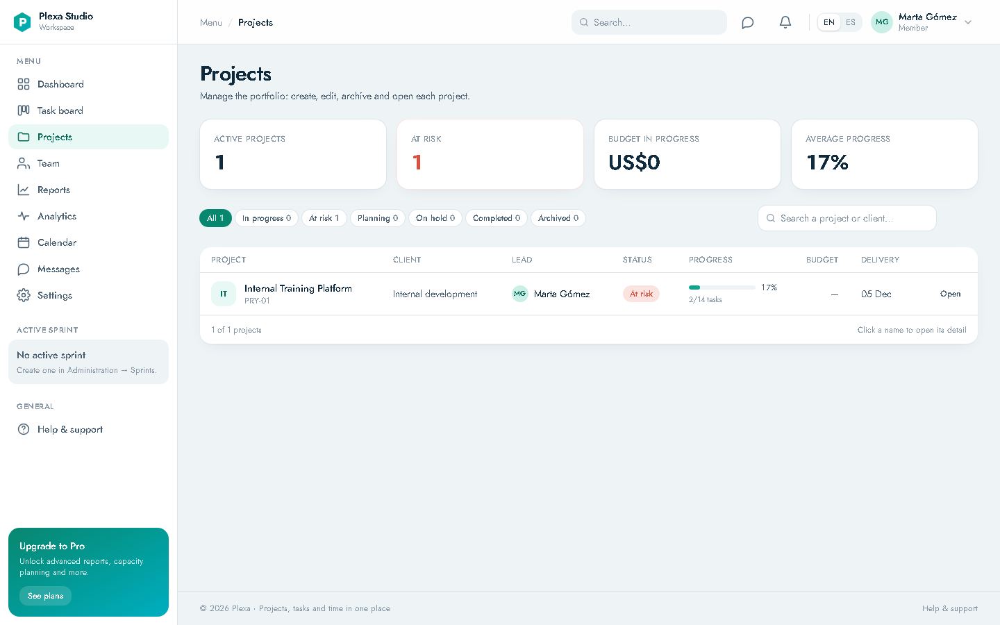
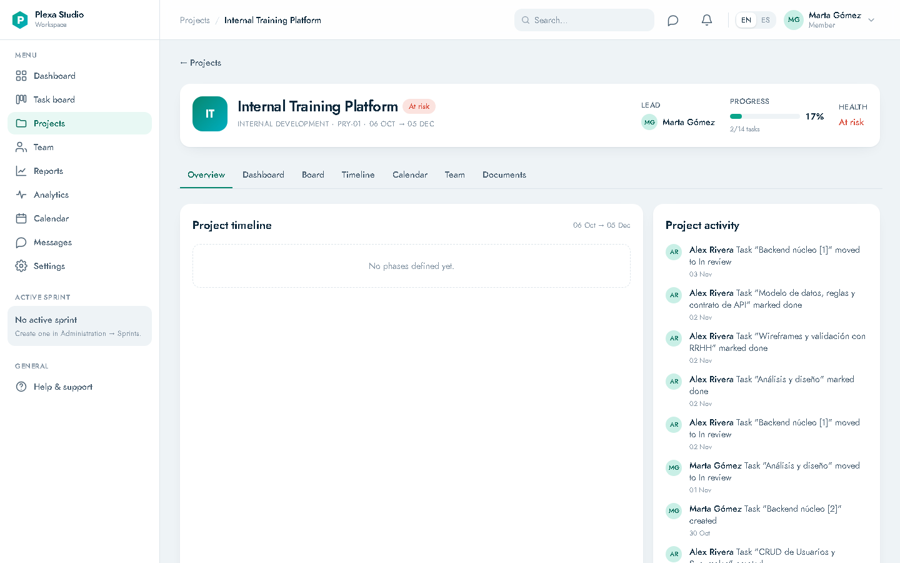
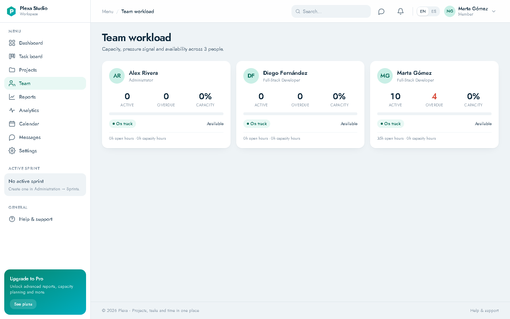
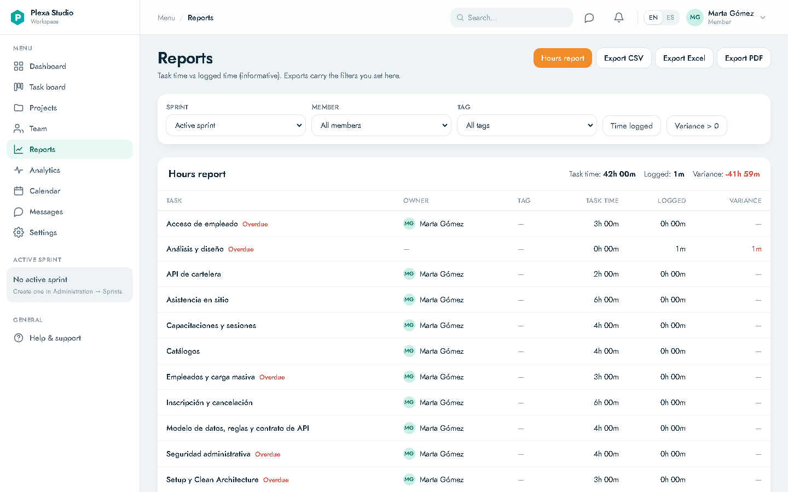
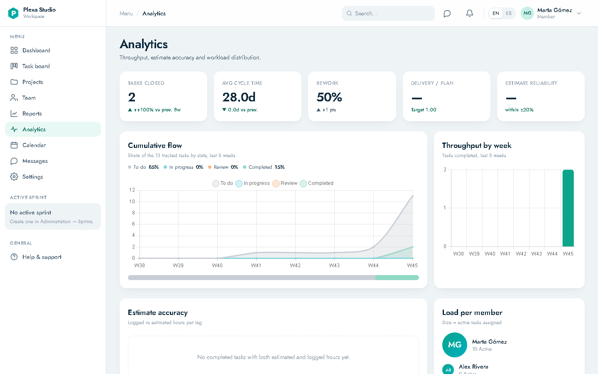
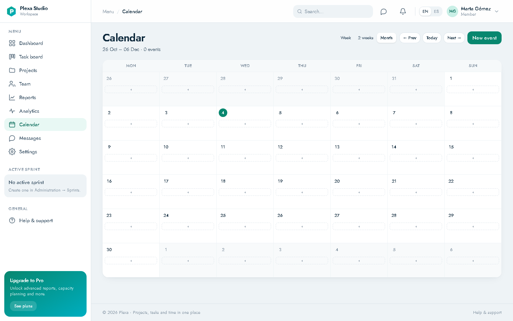

# Plexa

Plexa is a **project and operations management web app for studios and agencies**: projects, Kanban board, sprints,
time tracking, reports, analytics, calendar, messages and team workload. It is built as an
**ASP.NET Core MVC app with server-rendered Razor** and a professionally polished interface (no SPA, no jQuery, no Bootstrap).

The functional specification describing the reference app lives in [`spec/`](spec/README.md) (16 documents + screenshots).
Plexa reimplements it with its own brand and data.

---

## Features

| Area | Route | What it includes |
|---|---|---|
| Access | `/login`, `/forgot-password`, `/reset-password`, `/invitations` | Cookie-based Identity, invitations and `Admin`/`Member` roles |
| Dashboard | `/dashboard` | Sprint KPIs, status and priority breakdown, activity, time of day (htmx cards with skeletons) |
| Board | `/board` | 4 columns, project/person/text filters, search that includes subtasks, status drag, approval |
| Tasks | `/tasks/new`, `/tasks/{id}`, `/tasks/{id}/edit` | Modal form, two-level subtasks, checklist, dependencies with cycle detection, blocking |
| Time | `/api/v1/time/timer`, `/board/timer/*` | One active timer per user, manual entries, history |
| Projects | `/projects`, `/projects/{id}?tab=` | List and detail with tabs (overview, board, team, sprints, milestones, documents, activity) |
| Team | `/team` | Workload per person, weekly capacity, `On track` / `At risk` / `Overloaded` signals |
| Reports | `/reports`, `/reports/export` | Estimated vs logged time, filters and CSV / Excel / PDF export |
| Analytics | `/analytics` | Throughput, cycle time, rework, estimate reliability, cumulative flow |
| Calendar | `/calendar`, `/api/v1/calendar/events` | Month view, event types, create and detail |
| Messages | `/messages`, `/notifications/*` | Project and team threads, mentions, notification panel |
| Settings | `/settings?section=` | Profile, avatar, language preferences, SMTP mailbox with encrypted password |
| Administration | `/admin`, `/admin/members`, `/admin/projects`, `/admin/sprints` | `Admin` only: members, projects, sprints and archiving |

Languages: English by default and Spanish, via `IStringLocalizer` + `.resx` and the `plexa.culture` cookie.

---

## Screenshots

The real Plexa UI in English (the default language), with seed data.

| Sign in | Dashboard |
|---|---|
|  |  |

| Kanban board | Projects |
|---|---|
|  |  |

| Project detail | Team |
|---|---|
|  |  |

| Reports | Analytics |
|---|---|
|  |  |

| Calendar |
|---|
|  |

---

## Stack

| Layer | Technology |
|---|---|
| Platform | .NET 9 (`net9.0`), C# with `Nullable` and `ImplicitUsings` |
| Web | ASP.NET Core MVC + Razor Views (server-rendered) |
| Styling | Tailwind CSS v4 (CLI, tokens in `@theme`), self-hosted Jost typeface |
| Interactivity | htmx 2 + Alpine.js 3 (progressive enhancement) |
| Charts / icons | Chart.js 4, Lucide-style SVG icons |
| Data | EF Core 9 + SQL Server, migrations, `Guid` ids, `rowversion` |
| Auth | ASP.NET Core Identity (cookie), roles and project-membership policies |
| Validation | FluentValidation on the server, inline errors via htmx |
| Export | CsvHelper, ClosedXML, QuestPDF |
| Email | MailKit (the user's own SMTP mailbox, password protected with `IDataProtector`) |
| Logs | Serilog (console + rolling file) |
| Tests | xUnit + FluentAssertions, `WebApplicationFactory`, Playwright .NET |

> **Documented deviation:** the original target was .NET 10 LTS; the available environment only has SDK 9.0.102,
> so the solution compiles for `net9.0`. Changing `TargetFramework` to `net10.0` is enough once the SDK is installed.

---

## Requirements

- .NET SDK 9 (or later) and Git.
- A reachable SQL Server (tested against SQL Server 2012, compatibility level 110).
- To rebuild CSS: Node 20+ (`npm install`) **or** the standalone Tailwind CLI at `tools/tailwindcss.exe`.
- Optional for E2E: Playwright browsers (`pwsh bin/Debug/net9.0/playwright.ps1 install chromium`).

---

## Getting started

1. **Configure secrets** (never committed):

   ```bash
   cp .env.example .env
   # edit .env with your real connection string
   ```

   The connection string is read from `ConnectionStrings__Default`. You can also use `dotnet user-secrets`:

   ```bash
   dotnet user-secrets set "ConnectionStrings:Default" "Server=...;Database=Plexa;..." --project src/Plexa.Web
   ```

2. **Load the variables into the session** (PowerShell):

   ```powershell
   Get-Content .env | ForEach-Object {
     if ($_ -match '^\s*([A-Za-z_][A-Za-z0-9_]*)\s*=\s*(.*)$') {
       $k = $Matches[1]; $v = $Matches[2].Trim().Trim('"')
       [Environment]::SetEnvironmentVariable($k, $v, 'Process')
     }
   }
   ```

   In bash: `set -a; source .env; set +a`.

3. **Apply migrations and sample data**:

   ```bash
   dotnet run --project src/Plexa.Web -- --seed
   ```

   In `Development` the app also migrates and seeds on startup. If the login cannot create the database,
   create it empty beforehand (`CREATE DATABASE Plexa`).

4. **Run it**:

   ```bash
   dotnet run --project src/Plexa.Web
   ```

   Open `http://localhost:5087` (the port from the `http` profile in `launchSettings.json`) and sign in with a seed account:

   | Role | Email | Password |
   |---|---|---|
   | Admin | `alex.rivera@dwn.com.do` | `Plexa123$` |
   | Member | `marta.gomez@dwn.com.do` | `Plexa123$` |
   | Member | `diego.fernandez@dwn.com.do` | `Plexa123$` |

   > Change these credentials before any real deployment.

5. **CSS** (only if you touch Tailwind classes):

   ```bash
   npm install
   npm run build:css          # or: npm run build:css:standalone
   ```

   `wwwroot/css/site.css` is committed already compiled so a fresh clone works without Node.

---

## Tests

```bash
dotnet test Plexa.sln
```

| Project | What it covers |
|---|---|
| `tests/Plexa.UnitTests` | Domain rules: progress, dependency blocking, cycles, capacity, duration formatting, transitions |
| `tests/Plexa.IntegrationTests` | Routes and spec acceptance figures on a temporary `Plexa_Test_<guid>` database (created and dropped per run). Requires `Tests__ConnectionString`; skipped without it |
| `tests/Plexa.E2E` | Playwright smoke tests (login, board, modal). Require `E2E__BaseUrl` pointing at a running instance; skipped without it |

Integration tests **never** touch the development database `Plexa`.

---

## Docker

The database is external; the compose file only brings up the web service.

```bash
docker compose up --build
```

It exposes `http://localhost:8080` and mounts volumes for `storage/` (files and Data Protection keys) and `logs/`.
`Database__MigrateOnStartup=true` applies migrations on startup; seeding stays disabled.

---

## Structure

```
Plexa.sln
src/Plexa.Domain/          Entities, enums and pure rules (progress, blocking, capacity)
src/Plexa.Application/     Service contracts, DTOs and abstractions (IClock, IMailer, IFileStorage)
src/Plexa.Infrastructure/  PlexaDbContext, EF configurations, migrations, Identity, services, seed, exports, mail
src/Plexa.Web/             Controllers, Razor Views, ViewModels, ViewComponents, .resx resources, wwwroot
Styles/app.css             Tailwind entry point (@theme tokens)
tests/                     UnitTests · IntegrationTests · E2E
spec/                      Reference functional manual (source of truth)
```

### Key conventions

- Thin controllers; logic lives in `Domain`/`Application` and every view uses its own ViewModel (never entities).
- htmx pattern: the action returns the full page or, for htmx requests, a `PartialView`; client events travel in `HX-Trigger`.
- JSON errors follow RFC 7807 (`ProblemDetails`); custom 403/404/500 pages; PRG and antiforgery on every POST.
- Authorization always on the server (policies + project membership); the UI only hides controls.
- UTC dates in the database, injected `TimeProvider`, `async/await` with `CancellationToken`.
- Styling only with Tailwind utilities and the design-system components; minimal custom CSS.
- All copy goes through `.resx` (English by default, Spanish in `SharedResource.es.resx`).

---

## Decisions and assumptions

They are recorded in [`PROGRESS.md`](PROGRESS.md), along with the status of each phase. The most relevant ones:

- `net9.0` instead of `net10.0` because of SDK availability.
- SQL Server at compatibility level 110 (2012): no `OPENJSON`, `STRING_AGG`, `TRIM` or `CONCAT_WS`.
- `InBacklog` distinguishes backlog tasks: the board shows 14 nodes (parents + subtasks) while the dashboard/analytics
  show 13 tracked items, matching the spec figures.
- The administration screens (sprints, member/project creation, archiving) do not appear in the spec and were designed reasonably.
- Support: [support@plexa.app](mailto:support@plexa.app).

## License

Internal use / demonstration. The code includes no assets, logo or real data from the original app.
