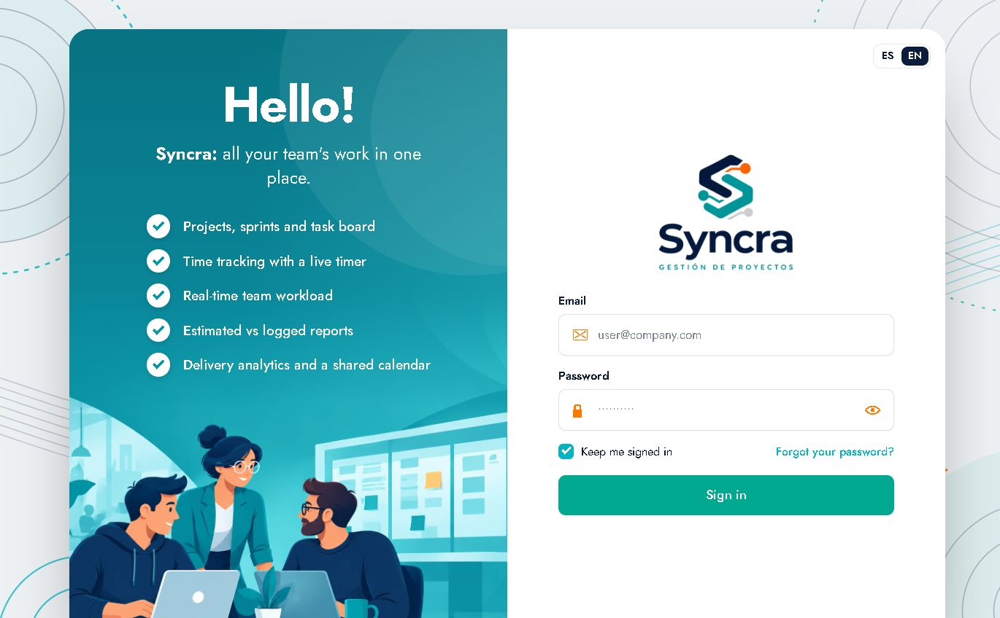
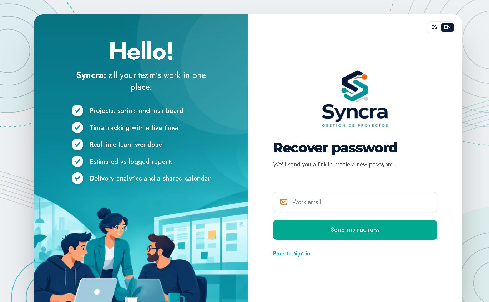
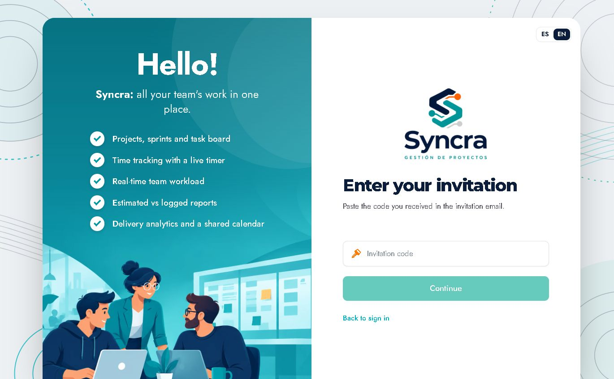

# 01 · Acceso y cuenta

Todo lo relacionado con entrar a Syncra, recuperar el acceso y aceptar una invitación.

---

## 1. Pantalla de inicio de sesión

Ruta: `/login`

La pantalla está dividida en dos mitades:

### Panel izquierdo (informativo)
- Saludo **"Hello!"**.
- Lema: *"Syncra: all your team's work in one place."*
- Lista de capacidades con checks:
  - Projects, sprints and task board
  - Time tracking with a live timer
  - Real-time team workload
  - Estimated vs logged reports
  - Delivery analytics and a shared calendar
- Ilustración del equipo de trabajo.

### Panel derecho (formulario)
- Selector de idioma **ES / EN** (esquina superior derecha).
- Logo Syncra y subtítulo *"GESTIÓN DE PROYECTOS"*.
- Campo **Email** con placeholder `user@company.com`.
- Campo **Password** con placeholder de puntos y botón de ojo (👁) para **mostrar/ocultar** la contraseña.
- Casilla **"Keep me signed in"** (mantener sesión iniciada), **marcada por defecto**.
- Enlace **"Forgot your password?"**.
- Botón **"Sign in"**.
- Pie: **"Don't have an account?"** + enlace **"I have an invitation"**.

### Cómo iniciar sesión
1. Abre `https://syncra.liobella.com`.
2. Escribe tu **correo corporativo**.
3. Escribe tu **contraseña** (puedes usar el ojo para verificarla).
4. Deja marcado **"Keep me signed in"** si quieres que la sesión persista al cerrar el navegador.
5. Pulsa **"Sign in"**.

Al autenticarse, la app redirige al **Dashboard** (`/dashboard`).

### Pantalla intermedia de sesión
Si ya había una sesión guardada, al entrar aparece brevemente un estado **"Restoring session"** (restaurando sesión) antes de mostrar la aplicación. No requiere acción.

### Sesión persistente
Con **"Keep me signed in"** activo, Syncra guarda la sesión y vuelve a entrar directamente en el Dashboard en visitas posteriores. Para terminar la sesión usa **Log out** (ver [13 · Notificaciones y menú](13-notificaciones-y-menu.md)).

### Errores de acceso
- Credenciales incorrectas: el formulario muestra el error y no avanza.
- Sin sesión y con una URL interna (por ejemplo `/board`), la app redirige a `/login` y, al autenticarte, continúa en el Dashboard.

---

## 2. Recuperar contraseña

Ruta: `/forgot-password` — enlace **"Forgot your password?"** del login.

### Cómo usarlo
1. Pulsa **"Forgot your password?"**.
2. En la pantalla **"Recover password"** escribe tu **correo de trabajo** en el campo *Work email*.
3. Pulsa **"Send instructions"**.
4. Revisa tu correo: Syncra envía un enlace para **crear una nueva contraseña**.
5. Abre el enlace del correo y define la nueva contraseña.
6. Vuelve al login con **"Back to sign in"**.

> El texto de la pantalla lo indica: *"We'll send you a link to create a new password."*

---

## 3. Aceptar una invitación

Ruta: `/invitations` — enlace **"I have an invitation"** del login.

### Cómo usarlo
1. Abre el correo de invitación que te envió un administrador del espacio.
2. Copia el **código de invitación**.
3. En el login pulsa **"I have an invitation"**.
4. En **"Enter your invitation"** pega el código en el campo *Invitation code*.
5. Pulsa **"Continue"**.
6. Completa tu registro/acceso según indique la app (la pantalla de invitación válida la genera el backend al validar el código).

Si el código no es válido o expiró, la app lo indicará y podrás volver con **"Back to sign in"**.

---

## 4. Idioma de la interfaz (ES / EN)

Hay dos lugares para cambiar el idioma:

1. **Pantallas públicas** (login, recuperar contraseña, invitaciones): botones **ES** y **EN** arriba a la derecha.
2. **Dentro de la app**: menú de usuario (arriba a la derecha) → fila **Language** con botones **ES / EN**; también en *Settings → Preferences*.

El cambio afecta a **este navegador**. La preferencia se guarda localmente, por lo que no cambia el idioma de tus compañeros.

> En este manual la interfaz se muestra en **EN** porque así estaba configurada la cuenta, pero todos los conceptos aplican igual en **ES**.

---

## 5. Cerrar sesión

1. Pulsa tu **avatar/nombre** en la esquina superior derecha.
2. En el menú elige **"Log out"**.
3. Vuelves a `/login`.

---

## 6. Datos de la cuenta visibles en la app

En **Settings → Profile** se muestra:

- Foto/avatar (iniciales si no hay imagen).
- **Nombre**: Leandro Sepulveda.
- **Email**: `lsepulveda@dwn.com.do`.
- **Puesto**: Full-Stack Developer.
- **Rol en el espacio**: Member.

El propio perfil indica: *"Ask a workspace admin to change your name, title or capacity."* → nombre, puesto y capacidad los gestiona un administrador.

Ver [12 · Configuración y perfil](12-configuracion-y-perfil.md).
