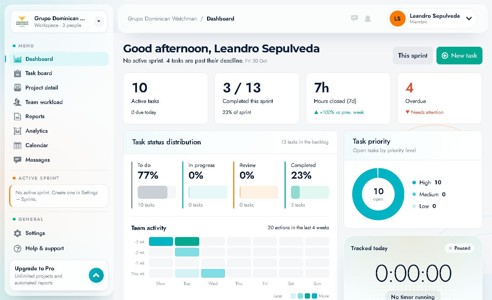
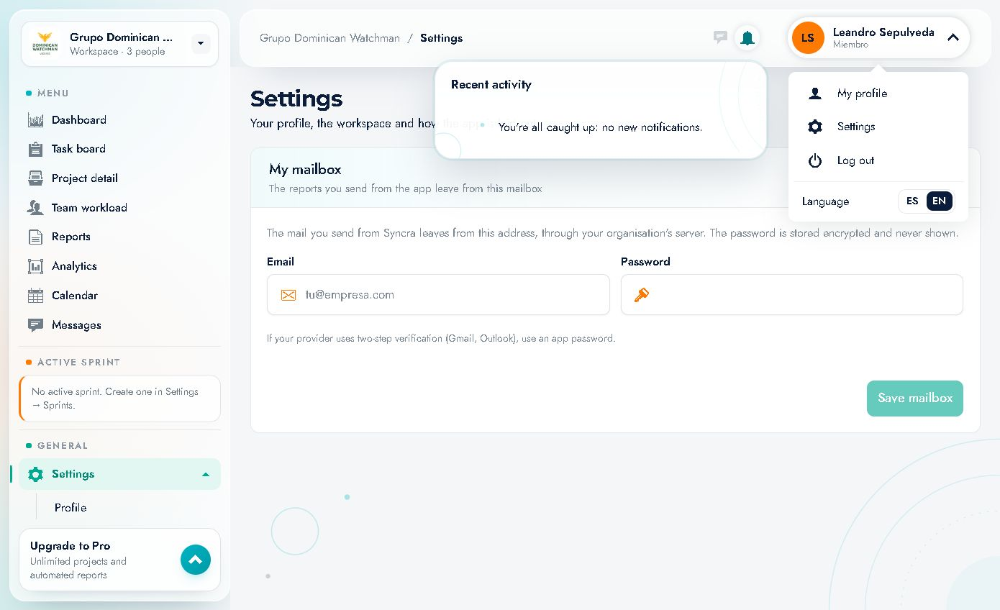

# 02 · Navegación e interfaz

Cómo está organizada la pantalla dentro de la aplicación y dónde está cada cosa.



---

## 1. Estructura de la pantalla

La app usa un layout de tres zonas:

```
┌──────────────────────────────────────────────────────────────┐
│ SIDEBAR (izquierda)  │  TOPBAR (cabecera)                     │
│                      ├────────────────────────────────────────┤
│  Espacio de trabajo  │  Breadcrumb · mensajes · campana ·     │
│  Menú principal      │  usuario                               │
│  Sprint activo       ├────────────────────────────────────────┤
│  General             │                                        │
│  Upgrade to Pro      │        CONTENIDO DE LA PÁGINA          │
│                      │                                        │
└──────────────────────┴────────────────────────────────────────┘
```

---

## 2. Barra lateral (sidebar)

### 2.1 Selector de espacio de trabajo (arriba)
Muestra:
- Logo cuadrado del espacio (o iniciales).
- Nombre: **Grupo Dominican Watchman**.
- Subtítulo: **Workspace · 3 people**.
- Una flecha (⌄) que indica que es un selector.

Si perteneces a más de un espacio de trabajo, este control permite cambiar entre ellos; el espacio activo determina todos los datos que ves (proyectos, equipo, reportes…).

### 2.2 Sección **MENU**
| Elemento | Ruta | Para qué sirve |
|---|---|---|
| **Dashboard** | `/dashboard` | Resumen general: KPIs, actividad, prioridades, cronómetro y carga del equipo |
| **Task board** | `/board` | Tablero Kanban global con todas las tareas |
| **Project detail** | `/projects` | Listado de proyectos (al abrir uno, su detalle) |
| **Team workload** | `/team` | Carga y capacidad de cada persona |
| **Reports** | `/reports` | Horas estimadas vs registradas y reporte por departamento |
| **Analytics** | `/analytics` | Métricas de entrega y calidad |
| **Calendar** | `/calendar` | Calendario compartido de eventos |
| **Messages** | `/messages` | Canales de proyecto y equipo |

El elemento activo se resalta con fondo celeste y una barra lateral turquesa.

### 2.3 Tarjeta **ACTIVE SPRINT**
Bloque informativo debajo del menú.
- Si hay sprint activo, muestra su nombre, fechas y progreso.
- Si no hay ninguno, muestra: **"No active sprint. Create one in Settings → Sprints."**

En el espacio documentado aparece **sin sprint activo**. La creación de sprints se hace en *Settings → Sprints*, sección que no está disponible para el rol **Member** (ver [14 · Roles y límites](14-roles-permisos-y-limites.md)).

### 2.4 Sección **GENERAL**
| Elemento | Acción |
|---|---|
| **Settings** | Abre configuración (Profile, Preferences, My mailbox) |
| **Help & support** | Abre tu cliente de correo con `mailto:support@syncra.app` |
| **Log out** | Cierra la sesión |

### 2.5 Tarjeta **Upgrade to Pro**
Bloque promocional:
- Título **"Upgrade to Pro"**.
- Texto: *"Unlimited projects and automated reports"*.
- Botón circular con flecha hacia arriba (`aria-label="Upgrade now"`).

> En la cuenta documentada, pulsar el botón **no abre ninguna pantalla ni modal** (no hay flujo de pago expuesto para este rol). Se documenta como aviso comercial.

---

## 3. Cabecera (topbar)

De izquierda a derecha:

1. **Botón de menú** (`aria-label="Open menu"`) — visible en pantallas estrechas; colapsa/expande la barra lateral.
2. **Breadcrumb**: `Grupo Dominican Watchman / <Página actual>`. Ejemplos: `Grupo Dominican Watchman / Task board`, `… / Settings`.
3. **Buscador global** (`Search tasks, people, docs…`): al enviar lleva a `/board?q=<texto>`. En ventanas estrechas se oculta por espacio.
4. **Icono de mensajes** (globo de chat) — acceso directo a `/messages`.
5. **Campana de notificaciones** — muestra un contador rojo con las no leídas (en la captura, **4**).
6. **Chip de usuario**: avatar con iniciales, nombre y rol (`Leandro Sepulveda` / `Miembro`); al pulsarlo abre el menú de usuario.

### Menú de usuario


| Opción | Acción |
|---|---|
| **My profile** | Va a *Settings → Profile* |
| **Settings** | Va a *Settings* |
| **Log out** | Cierra sesión |
| **Language** | Conmutador **ES / EN** |

---

## 4. Contenido de página

Cada página sigue el mismo patrón:

1. **Título grande** (p. ej. *"Task board"*).
2. **Subtítulo** con contexto y métricas resumidas (p. ej. *"All projects · Backlog · 14 tasks"*).
3. **Acciones** a la derecha (filtros, botones como **"New task"**, **"New event"**, **"Export CSV"**…).
4. **Tarjetas / tablas / gráficos** con los datos.

---

## 5. Comportamiento responsive

- En anchos reducidos, la barra lateral se oculta y aparece el botón **"Open menu"** en la cabecera para abrirla.
- Las columnas del tablero y las tablas se comprimen; algunas columnas quedan fuera de pantalla y se alcanzan desplazando horizontalmente la página o la tarjeta.
- Los modales se adaptan al ancho disponible.

---

## 6. Patrones de interacción comunes

| Patrón | Dónde aparece | Cómo se usa |
|---|---|---|
| **Chips de filtro** | Proyectos, Reportes | Pulsar para filtrar; el chip activo se resalta y muestra un contador |
| **Selects tipo chip** | Tablero (`All projects`, `Everyone`), Reportes | Desplegable nativo con opciones |
| **Modales** | New task, New event, detalle de tarea, detalle de evento | Se cierran con la X, con **Cancel** o haciendo clic fuera |
| **Paneles inline** | *Edit team*, *Edit* de tarea | El formulario sustituye el contenido; **Cancel** descarta cambios |
| **Toasts** | Al guardar acciones | Mensaje breve de confirmación |
| **Estados vacíos** | Mensajes, Timeline, Milestones | Explican qué falta y cómo continuar |
| **Estados de carga** | Toda la app | Texto "Loading…" / "Restoring session" / spinners |

---

## 7. Atajos de navegación

- **Breadcrumb** de la cabecera: no siempre es clicable; sirve de contexto.
- En el detalle de proyecto, el enlace **"← Projects"** vuelve al listado.
- En el detalle de proyecto, las pestañas cambian la URL: `?tab=Overview|Dashboard|Board|Timeline|Calendar|Team|Documents`.
- En el tablero, abrir una tarea agrega `?task=<id>` a la URL (se puede compartir el enlace directo a una tarea).
- En ajustes, la sección se refleja en `?section=profile|preferences|mailbox`.
