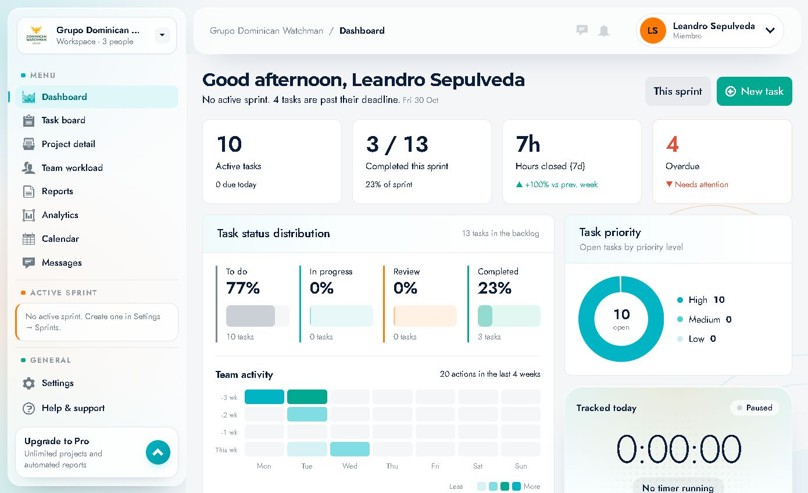
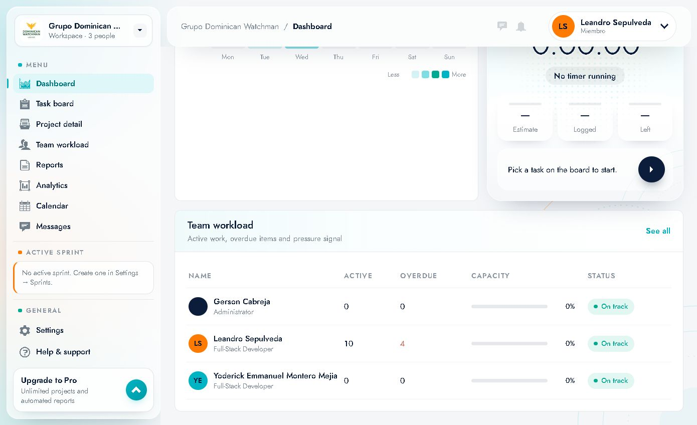

# 03 · Dashboard

Ruta: `/dashboard` · Elemento **"Dashboard"** del menú.

Es la pantalla de inicio tras iniciar sesión. Resume el estado del sprint, las prioridades, la actividad del equipo y tu tiempo del día.

---

## 1. Encabezado

- **Saludo personalizado**: *"Good afternoon, Leandro Sepulveda"* (cambia según la hora: Good morning / afternoon / evening).
- **Línea de contexto**: aviso del sprint y de tareas vencidas. En el ejemplo:
  *"No active sprint. 4 tasks are past their deadline. Fri 30 Oct"*
- **Botón "This sprint"**: lleva al tablero filtrado por el sprint actual (`/board`). Sirve para pasar del resumen al trabajo del sprint.
- **Botón "New task"**: abre el formulario de creación de tarea (ver [05 · Tareas](05-tareas-crear-editar-y-tiempo.md)).

---

## 2. Tarjetas KPI (fila superior)

| Tarjeta | Qué muestra | Ejemplo observado |
|---|---|---|
| **Active tasks** | Tareas abiertas (no completadas) y cuántas vencen hoy | `10` activas · `0 due today` |
| **Completed this sprint** | Tareas completadas / total del sprint y % | `3 / 13` · `23% of sprint` |
| **Hours closed (7d)** | Horas registradas y cerradas en los últimos 7 días, con comparación vs. semana previa | `7h` · `▲ +100% vs prev. week` |
| **Overdue** | Tareas pasadas de fecha, con señal de atención | `4` · `▼ Needs attention` |

**Cómo leerlas:** son el pulso del sprint. Si *Overdue* sube y *Completed* no, el sprint está en riesgo.

---

## 3. Task status distribution

Tarjeta con la distribución de todas las tareas del backlog por estado.

- Cabecera: **"13 tasks in the backlog"**.
- Cuatro bloques con **%**, nombre del estado, mini-barra y número de tareas:
  - **To do** — 77% · 10 tasks
  - **In progress** — 0% · 0 tasks
  - **Review** — 0% · 0 tasks
  - **Completed** — 23% · 3 tasks

Cada bloque tiene un color asociado (gris, celeste, durazno, verde) que se repite en el resto de la app.

**Uso:** detectar acumulación. Muchas tareas en *To do* y pocas en *In progress* suele indicar trabajo sin arrancar.

---

## 4. Team activity (mapa de calor)

- Cabecera: **"20 actions in the last 4 weeks"**.
- Filas: `-3 wk`, `-2 wk`, `-1 wk`, `This wk`.
- Columnas: `Mon` … `Sun`.
- Cada celda se colorea según la cantidad de acciones (leyenda **Less ↔ More**).

**Qué cuenta:** acciones del equipo (crear tareas, moverlas, completarlas, etc.). Sirve para ver ritmo y días de mayor actividad, no para evaluar personas.

---

## 5. Task priority

- Cabecera: **"Open tasks by priority level"**.
- Dona central con el total: `10 open`.
- Leyenda: **High 10 · Medium 0 · Low 0**.

**Uso:** priorizar. Si casi todo es *High*, la prioridad deja de discriminar y conviene recalibrar.

---

## 6. Tracked today (cronómetro)

Panel de seguimiento de tiempo del día.

- Estado: **"Paused"** y **"No timer running"**.
- Reloj grande: `0:00:00`.
- Tres métricas de la tarea en curso: **Estimate**, **Logged**, **Left** (vacías si no hay tarea).
- Botón circular de **play** (▶).
- Texto guía: **"Pick a task on the board to start."**

### Cómo se usa
1. Ve al **Task board** y abre una tarea.
2. En el detalle pulsa **"Start timer"**.
3. El cronómetro corre y el Dashboard muestra el tiempo acumulado del día.
4. Para detenerlo, vuelve a la tarea y pulsa **Pause/Stop** (el panel indica *Paused* cuando no corre).

> El panel no inicia el cronómetro por sí solo: hay que elegir una tarea.

---

## 7. Team workload (resumen)

Tabla con el estado de cada persona:

| Columna | Significado |
|---|---|
| **NAME** | Persona (avatar + nombre + puesto) |
| **ACTIVE** | Tareas activas asignadas |
| **OVERDUE** | Tareas vencidas asignadas |
| **CAPACITY** | Barra + % de capacidad usada |
| **STATUS** | Señal: **On track**, *At risk*, *Overloaded*… |

Enlace **"See all"** → `/team` (ver [07 · Equipo](07-equipo-y-capacidad.md)).

Datos del ejemplo:

| Persona | Puesto | Activas | Vencidas | Capacidad | Estado |
|---|---|---|---|---|---|
| Gerson Cabreja | Administrator | 0 | 0 | 0% | On track |
| Leandro Sepulveda | Full-Stack Developer | 10 | 4 | 0% | On track |
| Yoderick Emmanuel Montero Mejia | Full-Stack Developer | 0 | 0 | 0% | On track |

---

## 8. Rutina recomendada al entrar

1. Lee el **saludo/contexto**: ¿hay sprint activo? ¿cuántas vencidas?
2. Revisa **Overdue** y **Task priority** para decidir el foco.
3. Mira **Tracked today** y arranca el cronómetro en la tarea que vas a trabajar.
4. Usa **"This sprint"** o **"New task"** para pasar a la acción.
5. Al final del día, comprueba **Hours closed (7d)** y la carga del equipo.
