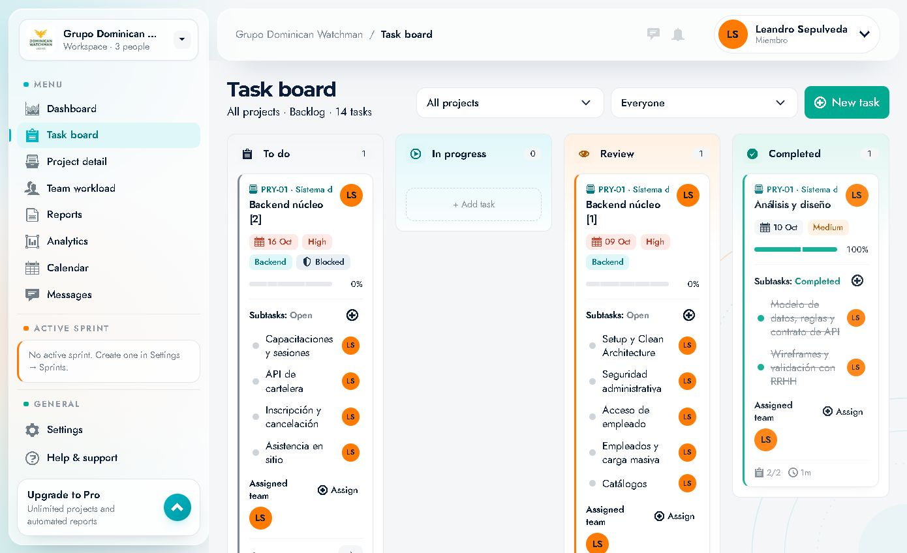
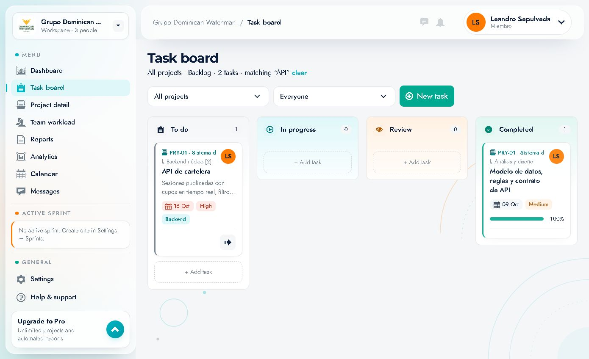

# 04 · Tablero de tareas (Task board)

Ruta: `/board` · Elemento **"Task board"** del menú.

Es el Kanban donde se ve y se mueve el trabajo. Muestra todas las tareas del espacio (o de un proyecto/persona) agrupadas por estado.



---

## 1. Encabezado y filtros

- Título: **"Task board"**.
- Subtítulo dinámico: **"All projects · Backlog · 14 tasks"** (filtro activo · ámbito · total de tareas).
- **Filtro de proyecto** (select `All projects`):
  - **All projects** → todas las tareas.
  - **Loose tasks** → solo tareas sin proyecto.
  - **PRY-01 · Sistema de Gestión de Capacitaciones Internas** → solo ese proyecto.
- **Filtro de persona** (select `Everyone`):
  - **Everyone**, **Gerson Cabreja**, **Leandro Sepulveda**, **Yoderick Emmanuel Montero Mejia**.
- **Botón "New task"**: abre el formulario de creación (ver [05](05-tareas-crear-editar-y-tiempo.md)).

Los filtros se combinan: por ejemplo, proyecto `PRY-01` + persona `Leandro Sepulveda` muestra solo las tareas de Leandro en ese proyecto.

### Búsqueda de texto

La cabecera incluye un buscador global (*placeholder* `"Search tasks, people, docs…"`) que al enviarse lleva a:

```
/board?q=<texto>
```

El tablero muestra entonces el subtítulo con el filtro aplicado y un enlace **"clear"**:

> *"All projects · Backlog · 2 tasks · matching “API” clear"*

La búsqueda **incluye subtareas**: las tarjetas encontradas muestran la ruta `↳ Tarea padre` encima del título.



- Pulsa **"clear"** para quitar la búsqueda y volver al tablero completo.
- Se puede guardar/compartir la URL con `?q=`.
- En ventanas estrechas el campo de búsqueda de la cabecera se oculta, pero el filtro `q` sigue funcionando por URL.

---

## 2. Columnas

Cuatro columnas fijas, en este orden:

| Columna | Color/icono | Contador | Significado |
|---|---|---|---|
| **To do** | Gris, portapapeles | nº de tarjetas | Pendiente de empezar |
| **In progress** | Celeste, play | nº | En desarrollo |
| **Review** | Durazno, ojo | nº | En revisión/validación |
| **Completed** | Verde, check | nº | Terminada |

Cada columna termina con un botón punteado **"+ Add task"** que crea una tarea directamente en ese estado.

> El contador de la cabecera de columna cuenta **tarjetas** (tareas padre), no subtareas.

---

## 3. Anatomía de una tarjeta

Ejemplo: *Backend núcleo [2]*

```
┌──────────────────────────────────────────────┐
│ ▣ PRY-01 · Sistema de Gestión de Capacita…   │  ← proyecto (código + nombre)
│ Backend núcleo [2]                    (LS)   │  ← título + avatar del responsable
│ 🗓 16 Oct   [High]   [Backend]   [🚫 Blocked]│  ← fecha, prioridad, etiqueta, bloqueo
│ ▓▓▓░░░░░░░░░░░░░░░░░░░░░░░░░░░░░░  0%        │  ← barra de progreso
│                                              │
│ Subtasks: Open                            ⊛  │  ← estado de subtareas + acción
│  ○ Capacitaciones y sesiones          (LS)   │
│  ○ API de cartelera                   (LS)   │
│  ○ Inscripción y cancelación          (LS)   │
│  ○ Asistencia en sitio                (LS)   │
│                                              │
│ Assigned team                    ⊙ Assign    │
│ (LS)                                         │
│ ──────────────────────────────────────────── │
│ 🗒 0/4                                   (▶) │  ← progreso subtareas + tiempo + timer
└──────────────────────────────────────────────┘
```

Elementos:

| Elemento | Detalle |
|---|---|
| **Código de proyecto** | `PRY-01` + nombre truncado; identifica a qué proyecto pertenece |
| **Título** | Nombre de la tarea; al pulsarlo se abre el detalle |
| **Avatar** | Responsable (iniciales y color) |
| **Fecha** | Fecha límite con icono de calendario; en rojo si está vencida |
| **Prioridad** | Chip `High` (rojo), `Medium` (ámbar), `Low` (gris) |
| **Etiqueta (tag)** | `Backend`, `Frontend`, `QA`… |
| **Blocked** | Chip oscuro con icono 🚫 cuando la tarea tiene dependencias sin completar |
| **Progreso** | Barra + % (por horas o por porcentaje, según la tarea) |
| **Subtasks** | Lista de subtareas con su estado (`Open`/`Completed`), responsable y acción ⊛ para gestionarlas |
| **Assigned team** | Personas asignadas + enlace **Assign** |
| **Pie** | `completadas/total` de subtareas a la izquierda y tiempo registrado (`1m`) + botón de timer (▶) a la derecha |
| **Move…** | Select para cambiar de estado (ver abajo) |

### Colores y señales
- Tarjeta con borde/acento de color = estado de la columna.
- `Blocked` indica que **no puede empezar** hasta que se completen y aprueben sus dependencias.
- El porcentaje se calcula según el modo de progreso de la tarea (por horas o por porcentaje de subtareas).

---

## 4. Mover una tarea

Cada tarjeta tiene un select **"Move…"** con las transiciones permitidas:

- Desde **To do**: `Move to In progress`, `Move to Review`.
- Desde **In progress**: `Move to To do`, `Move to Review`.
- Desde **Review**: `Move to To do`, `Move to In progress` (y a Completed si está aprobada).
- Desde **Completed**: opciones de reapertura.

Al elegir una opción, la tarjeta se mueve de columna y el cambio queda en la actividad del proyecto.

> Las transiciones mostradas dependen del estado actual y de los permisos. En la captura, To do ofrece *In progress* y *Review*; Review ofrece *To do* e *In progress*.

---

## 5. Añadir tareas rápidas

- **"+ Add task"** al pie de una columna: abre el formulario **New task** con el **proyecto ya precargado** (el del contexto del tablero). El estado se define después moviendo la tarjeta.
- **"New task"** en la cabecera: abre el formulario completo, donde eliges proyecto, responsable, fechas, subtareas, dependencias, etc.

---

## 6. Abrir el detalle de una tarea

Pulsa el **título** de la tarjeta. Se abre un modal y la URL pasa a `/board?task=<id>`.

El detalle incluye: badges, propietario, dependencias, estimación/registrado/deadline, prioridad, puntos, subtareas, checklist, cronómetro y movimiento de estado. Todo se explica en [05 · Tareas](05-tareas-crear-editar-y-tiempo.md).

---

## 7. Buenas prácticas en el tablero

1. **Una tarjeta = una unidad entregable.** Si tiene muchas subtareas, es normal; si tiene muchas responsabilidades distintas, divídela.
2. **Mantén el WIP bajo**: pocas tarjetas en *In progress*.
3. **Mueve la tarjeta al empezar**, no al terminar; así el Dashboard y los reportes reflejan la realidad.
4. **Usa `Blocked`/dependencias** para que nadie empiece trabajo que no puede terminar.
5. **Revisa el filtro** antes de concluir que "falta una tarea": puede estar oculta por proyecto o persona.
