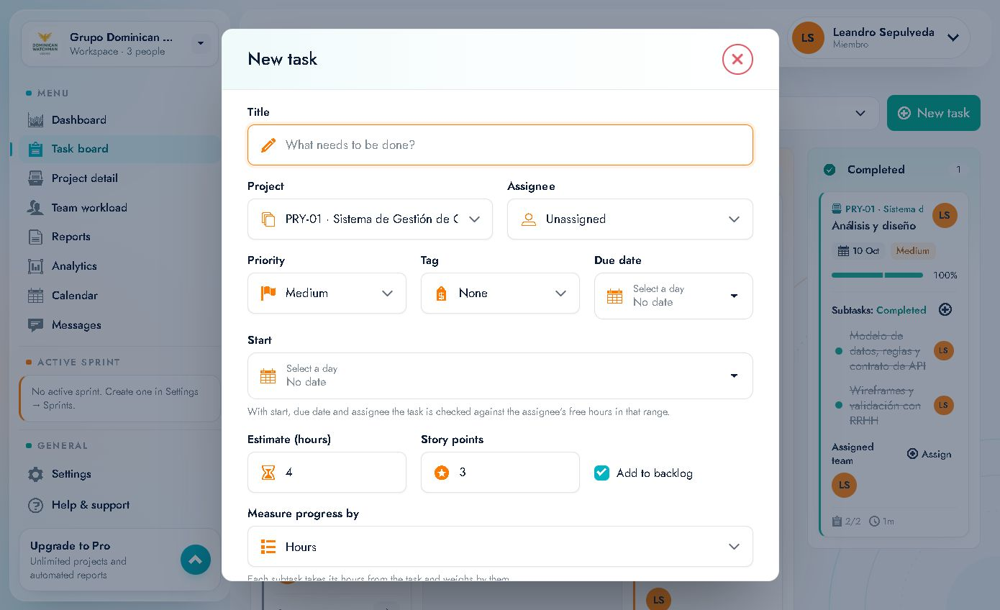
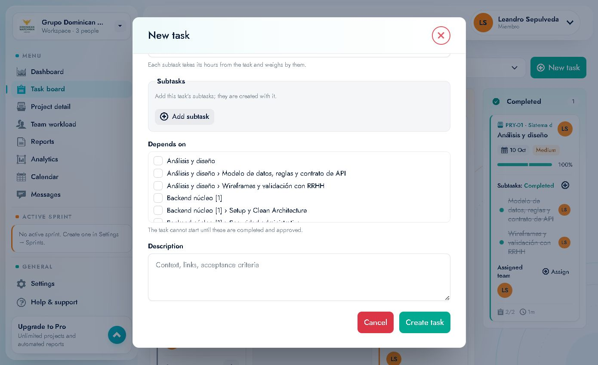
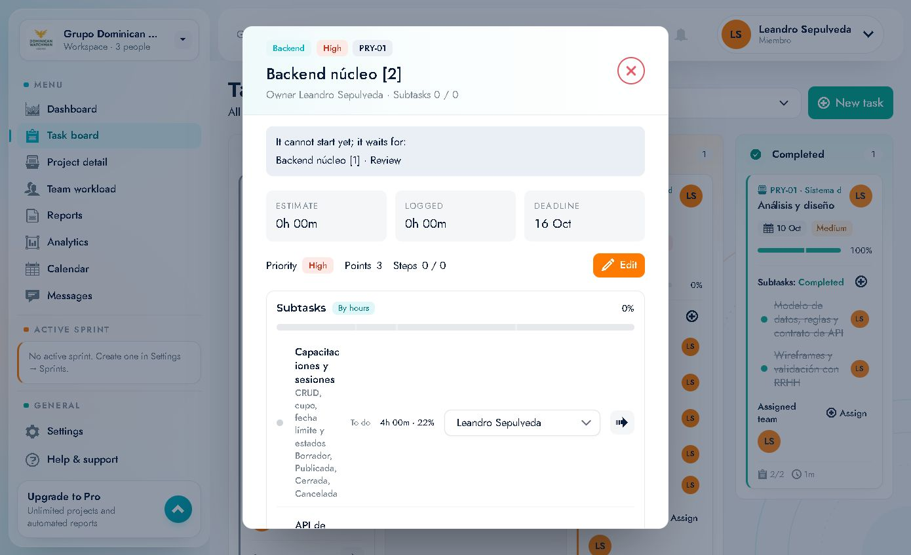

# 05 · Tasks: create, edit and log time

This document covers the complete life cycle of a task: creating it, viewing it, editing it, breaking it down into subtasks, managing dependencies, using the checklist and logging time.

---

## 1. Creating a task

From **Task board → "New task"**, **Dashboard → "New task"** or **"+ Add task"** in a column.

### Form fields

| Field | Type | Required | Description / options |
|---|---|---|---|
| **Title** | text | Yes | What needs to be done. Placeholder: *"What needs to be done?"* |
| **Project** | select | Yes | Target project or **"Loose task (no project)"** (loose task) |
| **Assignee** | select | No | `Unassigned` or any workspace member |
| **Priority** | select | No | `High`, `Medium` (default), `Low` |
| **Tag** | select | No | `None`, `Backend`, `Database`, `Design`, `Frontend`, `Research`, `QA`, `Performance` |
| **Due date** | day picker | No | Due date (`Select a day` / `No date`) |
| **Start** | day picker | No | Start date (`Select a day` / `No date`) |
| **Estimate (hours)** | number | No | Estimate in hours (default `4`) |
| **Story points** | number | No | Story points (default `3`) |
| **Add to backlog** | checkbox | — | Checked by default; the task goes into the backlog |
| **Measure progress by** | select | No | `Hours` (by hours) or `Percentage` (by percentage) |
| **Subtasks** | dynamic list | No | **"Add subtask"** button; they are created together with the task |
| **Depends on** | checkboxes | No | List of existing tasks/subtasks it depends on |
| **Description** | long text | No | *"Context, links, acceptance criteria"* |

> **Form defaults:** Priority `Medium`, Estimate `4` hours, Story points `3`, **Add to backlog** checked and progress `Hours`. When you open it from a column's **"+ Add task"**, the **project** arrives pre-loaded.

### Contextual form hints
- Under **Start**: *"With start, due date and assignee the task is checked against the assignee's free hours in that range."* → if you set a start, an end and an assignee, Syncra validates that person's **availability** in the range.
- Under **Measure progress by → Hours**: *"Each subtask takes its hours from the task and weighs by them."* → progress is weighted by the hours of each subtask.
- Under **Subtasks**: *"Add this task's subtasks; they are created with it."*
- Under **Depends on**: *"The task cannot start until these are completed and approved."*

### How to create a task (step by step)
1. Click **"New task"**.
2. Type the **title** (required).
3. Choose the **project** (or *Loose task*).
4. Assign an **assignee** (optional, recommended).
5. Adjust **priority** and **tag**.
6. Set the **start** and **due** dates if applicable.
7. Add an **estimate** and **story points**.
8. Leave **"Add to backlog"** checked if it does not enter the sprint yet.
9. Choose how to measure progress (**Hours** or **Percentage**).
10. Add **subtasks** and tick **dependencies** if any exist.
11. Write the **description** with context and acceptance criteria.
12. Click **"Create task"**. If you do not want to save, **"Cancel"**.

> The close button (X) or **Cancel** discards the form. Nothing is saved.

### Errors and validations
- Without a title, the form does not create the task.
- If `Start` > `Due date`, the app flags it.
- If the assignee has no free hours in the range, a warning is shown (capacity).

---

## 2. Task detail

It opens when you click the title on the board (URL `…/board?task=<id>`).

### Header
- Chips: tag (`Backend`), priority (`High`), project (`PRY-01`).
- Large title: **Backend núcleo [2]**.
- Subtitle: **"Owner Leandro Sepulveda · Subtasks 0 / 0"**.
- **X** to close.

### Dependency warning
If the task cannot start:
> *"It cannot start yet; it waits for: Backend núcleo [1] · Review"*

### Metrics
| Block | Meaning |
|---|---|
| **ESTIMATE** | Estimated hours (`0h 00m`) |
| **LOGGED** | Logged time (`0h 00m`) |
| **DEADLINE** | Due date (`16 Oct`) |
| **Priority** | `High` |
| **Points** | Story points (`3`) |
| **Steps** | Checklist completed/total (`0 / 0`) |

### Actions
- **"Edit"**: opens the editing form (see below).
- **"Subtasks"**: list of subtasks with their global % and **"By hours"** mode.

Each subtask shows:
- Title and description.
- Status (`To do`), hours and weight % (`4h 00m · 22%`).
- **Assignee** select.
- **Move…** select (`Move to In progress`, `Move to Review`…).

- **"Task hours not allocated to subtasks: 0h 00m"** → hours of the parent task that are not distributed among subtasks.
- **"New subtask"**: creates a subtask.
- **"Checklist"**: quick steps; if it is empty: *"No steps yet. Break the task down below."*
- **"Start timer"**: starts the task timer.
- **"Move to…"**: changes the task status.

---

## 3. Editing a task

**"Edit"** button inside the detail.

### Editable fields
| Field | Notes |
|---|---|
| **Title** | Text |
| **Description** | Text |
| **Project** | *"It can move to another project until it is started; its subtasks go with it and its dependencies are removed."* → only before starting; it drags the subtasks along and loses dependencies |
| **Priority** | `Low`, `Medium`, `High` |
| **Tag** | Same as in creation |
| **Assignee** | Member or `Unassigned` |
| **Start** | Date |
| **Due date** | Date |
| **Estimate (hours)** | Number |
| **Story points** | Number |
| **Depends on** | Checkboxes (same hint as in creation) |
| **Measure progress by** | `Hours` / `Percentage`; **locked** if the task already has subtasks: *"It cannot change: the task already has subtasks."* |

### Save or discard
- **"Save"** applies the changes.
- **"Cancel"** discards them and returns to the detail.
- Status/project changes are recorded in the **project activity**.

---

## 4. Subtasks

Subtasks are child tasks that allow the work to be split.

### Create
- From the **New task** form with **"Add subtask"** (they are created together with the task).
- From the detail with **"New subtask"**.

### Behavior
- They have their own status, assignee, hours and date.
- The **parent task %** is calculated according to the mode:
  - **Hours**: each subtask weighs according to its hours.
  - **Percentage**: each subtask weighs the same.
- The board list shows `Subtasks: Open/Completed` and how many are done (`0/4`).
- They can be moved to another status individually without moving the parent task.

### Good practices
- Estimate hours per subtask so that the % is meaningful.
- Do not mix subtasks with different assignees without assigning them: they appear as *Unassigned*.
- If a subtask is actually a large deliverable, turn it into a standalone task.

---

## 5. Dependencies ("Depends on")

- They are defined in **New task** and in **Edit**.
- You can depend on a **task** or on a specific **subtask** (they are listed as `Task › Subtask`).
- While the dependency is not **completed and approved**, the task shows the **"It cannot start yet; it waits for: …"** warning and the **Blocked** chip on the board.
- If you move a task to another project, **its dependencies are removed**.

**Typical use:** prevent QA from starting before Backend finishes, or prevent the frontend from consuming an endpoint that does not exist yet.

---

## 6. Checklist (Steps)

- **"Checklist"** block in the detail.
- Add steps with the *"Add a step and press Enter"* field.
- Each step is marked as done; the **Steps** counter goes up.
- It is independent of the subtasks: use it for small steps (e.g. "update the documentation", "notify support").

---

## 7. Logging time (timer)

### Start
1. Open the task.
2. Click **"Start timer"**.
3. The button changes to a pause state and time starts running.
4. **Dashboard → Tracked today** reflects the time of the day.

### Stop / pause
- Go back to the task and click the pause/stop control.
- The time becomes **Logged** on the task and feeds *Hours closed (7d)* and the reports.

### Practical rules
- Only one timer active at a time (the Dashboard panel shows the task in progress).
- If you forgot to start it, the time can be adjusted from the entry's edit (depending on permissions).
- Logged time is compared with **Estimate** in *Reports* (variance).

---

## 8. Moving a task's status

Three ways:
1. **"Move…"** select on the board card.
2. **"Move to…"** select in the detail.
3. **"Move…"** select per subtask.

Statuses: **To do → In progress → Review → Completed** (with rollbacks allowed).

> In many teams, *Review* is the status where someone else validates before *Completed*; the app records who moved it and when in the project activity.

---

## 9. Delete / archive

Deleting tasks is not exposed as a main action in the detail for the **Member** role. If you need to delete or archive, do it with an administrator (see [14 · Roles](14-roles-permisos-y-limites.md)).

---

## 10. Summary of mental shortcuts

| I want to… | I'll go to… |
|---|---|
| Create new work | **New task** |
| See the full detail | Click the card **title** |
| Change dates/hours/points | **Edit** |
| Split the work | **Add subtask** / **New subtask** |
| Avoid starting too early | **Depends on** |
| Measure my time | **Start timer** |
| Change column | **Move…** |
| See why it is blocked | *"It cannot start yet…"* warning |
