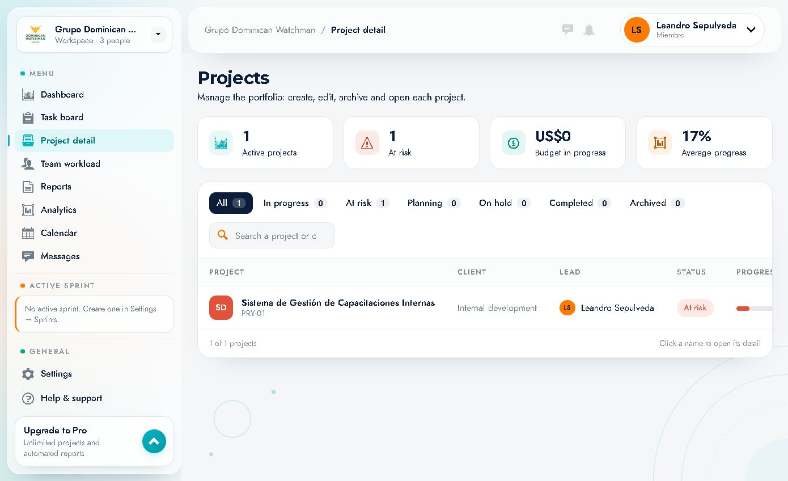
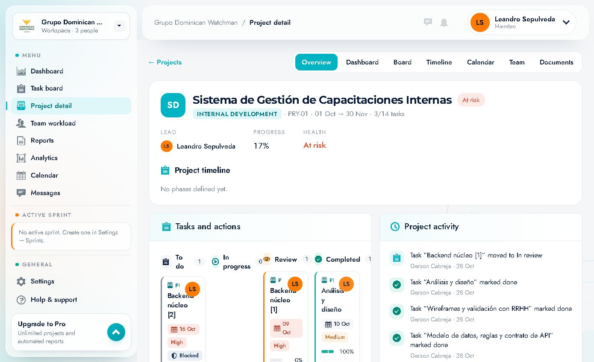
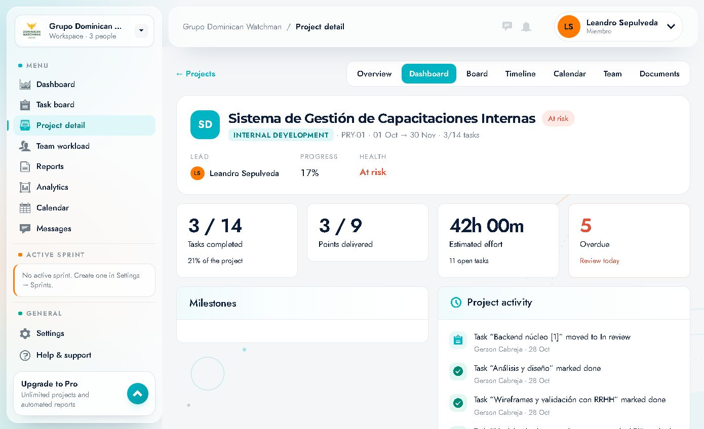
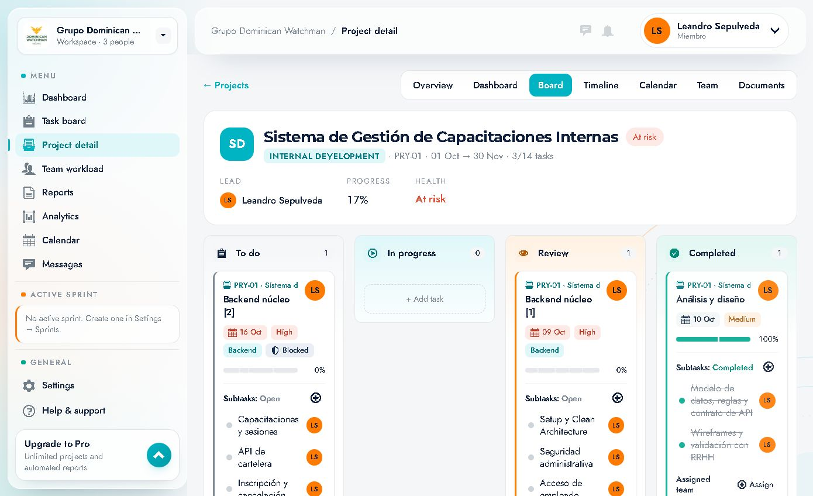
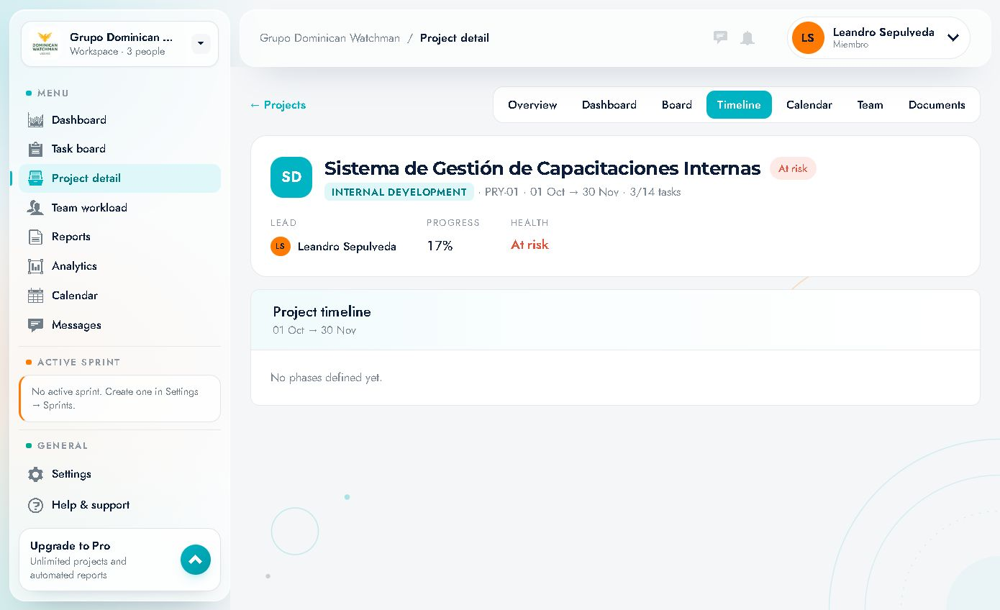
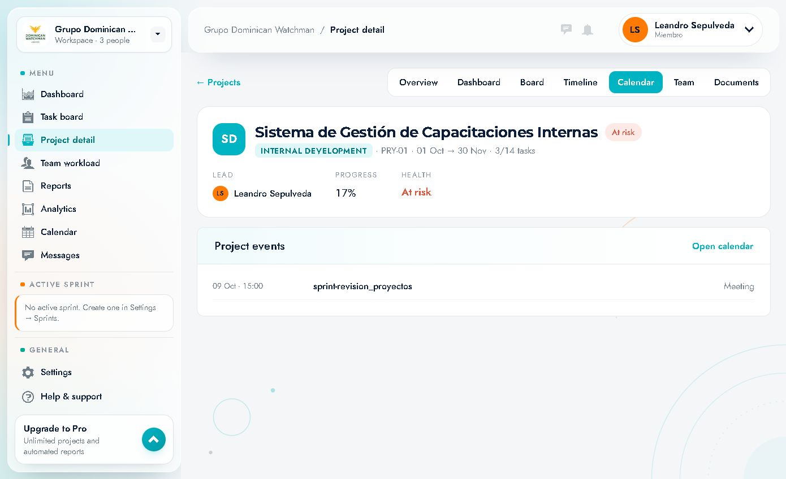
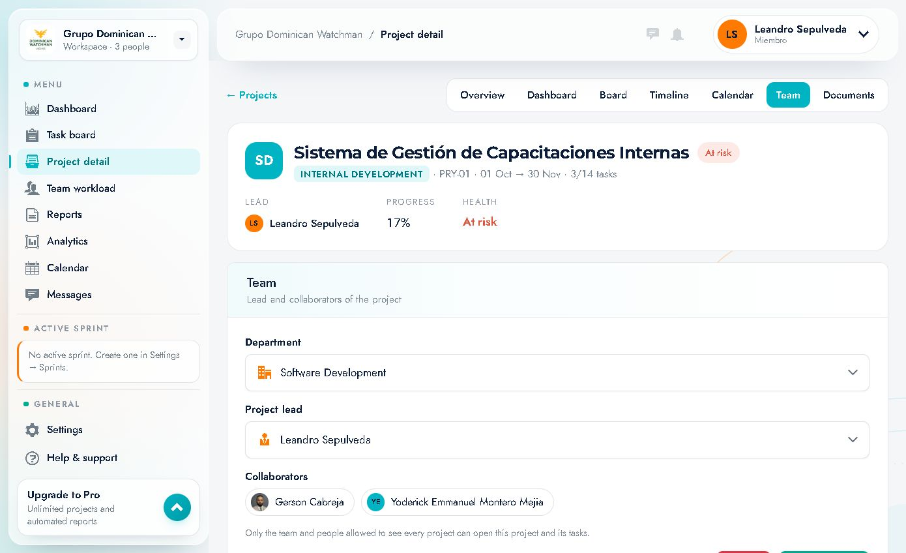
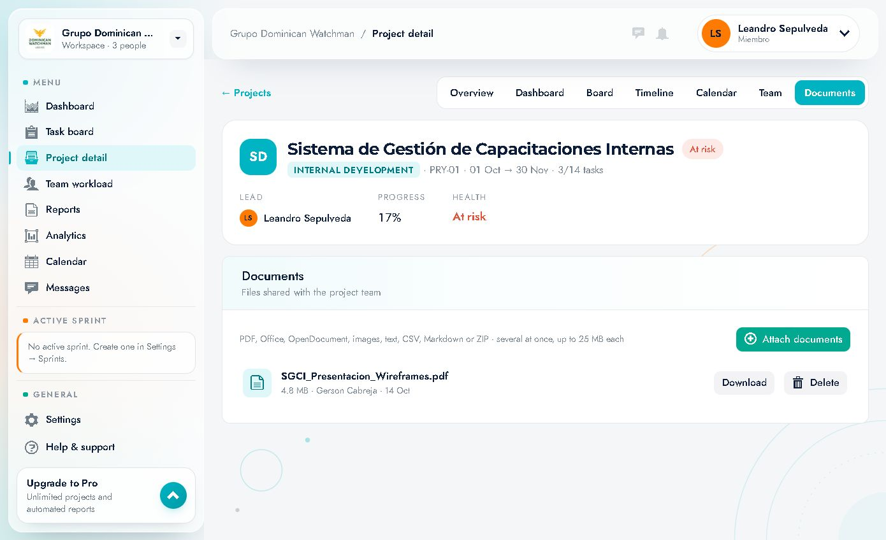

# 06 · Projects

Listing route: `/projects` · **"Project detail"** menu item.
Detail route: `/projects/<id>?tab=Overview|Dashboard|Board|Timeline|Calendar|Team|Documents`

---

## 1. Project list

### Header
- Title **"Projects"**.
- Subtitle: *"Manage the portfolio: create, edit, archive and open each project."*

### KPI cards
| KPI | Example | Meaning |
|---|---|---|
| **Active projects** | `1` | Projects in progress |
| **At risk** | `1` | Projects whose health is at risk |
| **Budget in progress** | `US$0` | Budget of the projects in progress |
| **Average progress** | `17%` | Average progress |

### Status filters (chips with counter)
`All 1` · `In progress 0` · `At risk 1` · `Planning 0` · `On hold 0` · `Completed 0` · `Archived 0`

- **All**: every project.
- **In progress**: being executed.
- **At risk**: with problems (dates, workload, dependencies…).
- **Planning**: still being planned.
- **On hold**: paused.
- **Completed**: finished.
- **Archived**: archived (outside the operational view).

### Search
Field *"Search a project or c…"* (name or client). Filters the table as you type.

### Table
| Column | Content |
|---|---|
| **PROJECT** | Icon/initials, name and code (`PRY-01`) |
| **CLIENT** | Client (`Internal development`) |
| **LEAD** | Lead with avatar |
| **STATUS** | Status chip (`At risk`, `In progress`…) |
| **PROGRESS** | Bar + % |
| **BUDGET** | Budget (`—` if not defined) |
| **DELIVERY** | Delivery date (`30 Nov`) |
| **ACTIONS** | Open detail |

Footer: **"1 of 1 projects"** and the hint **"Click a name to open its detail"**.

### Opening a project
Click the project **name** (or its row) → the detail opens with 7 tabs.

> In the **Member** role there is no "New project" button. Creation/editing/archiving is done with administrator permissions (the page subtitle mentions it).

---

## 2. Project detail — shared header

All tabs share one header:

- **"← Projects"** link to go back.
- Tabs: **Overview · Dashboard · Board · Timeline · Calendar · Team · Documents**.
- Identity card:
  - Initials/square `SD`.
  - Name: **Sistema de Gestión de Capacitaciones Internas**.
  - Health chip: **At risk**.
  - Meta line: `INTERNAL DEVELOPMENT · PRY-01 · 01 Oct → 30 Nov · 3/14 tasks`.
  - **LEAD**: Leandro Sepulveda.
  - **PROGRESS**: 17%.
  - **HEALTH**: At risk.

The tabs change the URL (`?tab=…`) and can be linked directly.

---

## 3. Overview tab

Executive and operational summary.

### Project timeline
- Range `01 Oct → 30 Nov`.
- If there are no phases: **"No phases defined yet."** (phases are defined with management permissions).

### Tasks and actions
Embedded mini-board with the 4 columns and their cards (To do 1, In progress 0, Review 1, Completed 1). It lets you see the status without leaving the project.

### Project activity
Chronology of actions, from the most recent to the oldest:
- *Task "Backend núcleo [1]" moved to In review* — Gerson Cabreja · 28 Oct
- *Task "Análisis y diseño" marked done* — Gerson Cabreja · 28 Oct
- *Task "Wireframes y validación con RRHH" marked done* — Gerson Cabreja · 28 Oct
- *Task "Modelo de datos, reglas y contrato de API" marked done* — Gerson Cabreja · 28 Oct
- *Task "Análisis y diseño" moved to In review* — Leandro Sepulveda · 27 Oct
- *Task "CRUD de Usuarios y Sucursales" created* — Gerson Cabreja · 06 Oct
- … (creations and moves since 01 Oct)

**Use:** audit who did what and when; spot work with no movement.

---

## 4. Dashboard tab

Project metrics:

| Metric | Example | Reading |
|---|---|---|
| **Tasks completed** | `3 / 14` · `21% of the project` | Progress by tasks |
| **Points delivered** | `3 / 9` | Progress by story points |
| **Estimated effort** | `42h 00m` · `11 open tasks` | Estimated effort still pending |
| **Overdue** | `5` · `Review today` | Overdue tasks and tasks to review today |

### Milestones
Section for project milestones. In the example it appears empty.

### Project activity
The same chronology as in the Overview.

**Use:** answer "how much is left?" with two units (tasks and points) and see whether the pending effort is high.

---

## 5. Board tab

- It is the **same Kanban board** as `/board`, but **filtered to this project**.
- To do / In progress / Review / Completed columns with their cards.
- It lets you open tasks, move them, assign them and add tasks to the project.
- The global board header (`All projects · Backlog · 14 tasks`) changes here to the project context.

**Use:** work on the project day to day without noise from other projects.

---

## 6. Timeline tab

- Title **"Project timeline"** with the date range.
- Shows the project **phases** on a timeline.
- If there are no phases: **"No phases defined yet."**

**Use:** communicate the plan by stages (discovery, design, development, QA, delivery) and compare it with the task dates.

---

## 7. Calendar tab

- Project **"Project events"** list.
- **"Open calendar"** link → global calendar.
- Each event shows date/time, title and type (`Meeting`).

Example: `09 Oct · 15:00 — sprint-revision_proyectos — Meeting`.

**Use:** see the project meetings and deadlines without filtering the whole calendar.

---

## 8. Team tab

### Read-only view
- **DEPARTMENT**: department and area (`Software Development · Area lead: Gerson Cabreja`).
- **PROJECT LEAD**: project lead with their position (`Leandro Sepulveda · Full-Stack Developer · Lead`).
- **COLLABORATORS**: collaborators (or **"No collaborators yet."**).
- Note: *"Only the team and people allowed to see every project can open this project and its tasks."*

### Editing the team
**"Edit team"** button → inline form:

| Field | Options |
|---|---|
| **Department** | `Choose a department`, `Software Development`… |
| **Project lead** | `No lead` or any member |
| **Collaborators** | Member chips (multiple selection) |
| **Cancel / Save team** | Discard / save |

**Important:** access to the project depends on this configuration. If you are not on the team (and have no global permission), you will not see the project or its tasks.

---

## 9. Documents tab

### What it accepts
Screen text:
> *"PDF, Office, OpenDocument, images, text, CSV, Markdown or ZIP · several at once, up to 25 MB each"*

Allowed types (file picker attribute):
`.pdf, .doc, .docx, .xls, .xlsx, .ppt, .pptx, .odt, .ods, .png, .jpg, .jpeg, .gif, .webp, .txt, .md, .csv, .zip`

- **Several files at once**.
- **Maximum 25 MB per file**.

### Uploading
1. Click **"Attach documents"**.
2. Select one or more files.
3. They are uploaded and appear in the list.

### Document list
Each file shows:
- Icon by type.
- Name (`SGCI_Presentacion_Wireframes.pdf`).
- Size · author · date (`4.8 MB · Gerson Cabreja · 14 Oct`).
- **Download**.
- **Delete** (with confirmation; requires permissions).

**Use:** keep deliverables, contracts, wireframes and evidence together with the project.

---

## 10. Recommended project workflow

1. **List** → filter by status and find the project.
2. **Overview** → understand health, dates, progress and recent activity.
3. **Dashboard** → review tasks/points and overdue items.
4. **Board** → work on the day's tasks.
5. **Timeline** → validate the plan by phases.
6. **Team** → confirm who takes part and adjust collaborators (if you have permission).
7. **Calendar** → review meetings and deadlines.
8. **Documents** → store and share deliverables.

---

## 11. Frequently asked questions

**Why don't I see a project?**
Because you are not on the team and you do not have permission to see every project. Ask to be added under **Team → Edit team**.

**Why is the progress 17% if there are 3 of 14 tasks?**
21% by tasks, but the project progress (17%) may be weighted by hours or points.

**Who can create projects?**
The subtitle states that they are created/edited/archived from this page; in the Member role the action is not shown. An administrator does it.

**Can tasks be moved between projects?**
Yes, from the task's **Edit**, as long as it has not started. Its subtasks move with it and **the dependencies are lost**.
