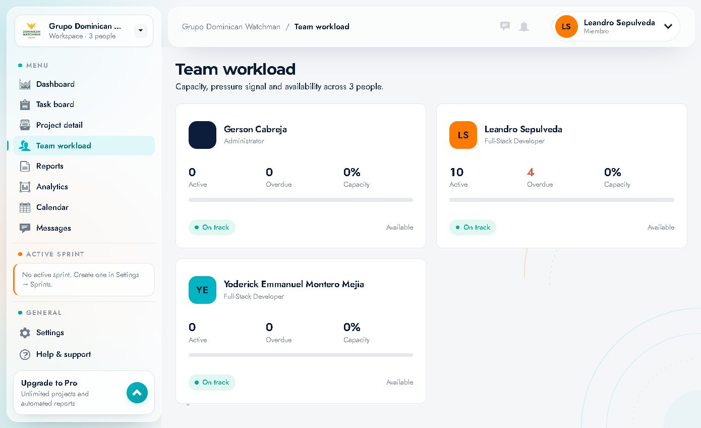

# 07 · Team and capacity (Team workload)

Route: `/team` · **"Team workload"** menu item. It can also be reached through **"See all"** from the Dashboard.

It shows how much work each person has, how much of it is overdue and their capacity signal.



---

## 1. Header

- Title **"Team workload"**.
- Subtitle: *"Capacity, pressure signal and availability across 3 people."*
- It has no filters or actions: it is a read-only view.

---

## 2. Card per person

Each member appears in a card:

```
┌──────────────────────────────────────────────┐
│ (GC)  Gerson Cabreja                         │
│       Administrator                          │
│                                              │
│   0          0            0%                 │
│  Active    Overdue      Capacity             │
│  ▓▓▓▓▓▓▓▓▓▓▓▓▓▓▓▓▓▓▓▓▓▓▓▓▓▓▓▓▓▓▓  (bar)     │
│                                              │
│  ● On track                      Available   │
└──────────────────────────────────────────────┘
```

### Metrics
| Metric | Meaning |
|---|---|
| **Active** | Active tasks assigned |
| **Overdue** | Overdue tasks assigned (in red) |
| **Capacity** | % of capacity consumed; progress bar |
| **Signal** | Status chip: **On track**, *At risk*, *Overloaded*… |
| **Availability** | Text on the right: **Available** or the corresponding status |

### Observed data

| Person | Position | Active | Overdue | Capacity | Signal |
|---|---|---|---|---|---|
| Gerson Cabreja | Administrator | 0 | 0 | 0% | On track · Available |
| Leandro Sepulveda | Full-Stack Developer | 10 | 4 | 0% | On track · Available |
| Yoderick Emmanuel Montero Mejia | Full-Stack Developer | 0 | 0 | 0% | On track · Available |

> **Note:** capacity shows 0% because there is no active sprint with committed capacity. Once a sprint is created and capacity is assigned, these percentages and signals become meaningful.

---

## 3. How to read capacity

| Signal | What it means | What to do |
|---|---|---|
| **On track** | Workload within expectations | Maintain |
| **At risk** | High workload or accumulated overdue tasks | Review priorities, reassign |
| **Overloaded** | Above capacity | Move work to someone else or to the next sprint |
| **Available** | With headroom | Can take on new work |

The signal combines **active tasks**, **overdue tasks** and **sprint capacity**. It is an alert, not a performance evaluation.

---

## 4. Practical use

### Before assigning a task
1. Open **Team workload**.
2. Look at who is **Available** and has low capacity.
3. Avoid assigning to whoever is **Overloaded** or has many **Overdue** tasks.
4. Assign from the task (**Assignee**) or from the **New task** form.

### In the daily meeting
1. Review **Overdue** per person (red).
2. Identify blockers (tasks with `Blocked` on the board).
3. Rebalance: move tasks or change the sprint scope.

### When planning the sprint
1. Check each person's capacity.
2. Commit only the work that fits.
3. After creating the sprint (administrator), come back here to validate the percentages.

---

## 5. Relationship with other screens

| Screen | Relationship |
|---|---|
| **Dashboard → Team workload** | Summarized version in a table with a **See all** link |
| **Task board** | The `Everyone` filter lets you see only one person's tasks |
| **Reports** | Filter by **Member** to see each person's hours and variance |
| **Analytics → Load per member** | Bubbles sized by active workload |
| **Settings → Profile** | Shows your position; capacity is adjusted by an administrator |
