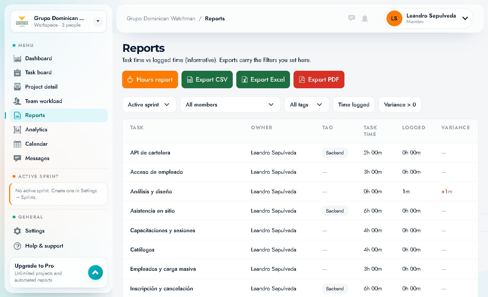

# 08 · Reports

Route: `/reports` · **"Reports"** menu item.

It compares **estimated time (task time)** with **logged time** and offers a report by department. Exports respect the active filters.

---

## 1. Header and actions

- Title **"Reports"**.
- Subtitle: *"Task time vs logged time (informative). Exports carry the filters you set here."*
- Buttons:
  - **"Hours report"** (orange button, active by default): hours view by task.
  - **"Export CSV"**.
  - **"Export Excel"**.
  - **"Export PDF"**.

---

## 2. Filters

| Filter | Options | Effect |
|---|---|---|
| **Sprint** | `Active sprint`, other sprints | Restricts to the selected sprint |
| **Member** | `All members`, each person | Only that person's tasks |
| **Tag** | `All tags`, `Backend`, … | Only tasks with that tag |
| **Time logged** (button) | on/off | Shows only tasks **with logged time** |
| **Variance > 0** (button) | on/off | Shows only tasks where logged time **exceeds** the estimate (overconsumption) |

The filters combine and are reflected in the table, in the totals and in the exported files.

---

## 3. "Hours report" table

| Column | Meaning |
|---|---|
| **TASK** | Task name |
| **OWNER** | Owner |
| **TAG** | Tag (`Backend` or `—`) |
| **TASK TIME** | Estimated hours |
| **LOGGED** | Logged time |
| **VARIANCE** | Difference logged − estimated (`+1m` in red if there is an excess, `—` if not applicable) |

### Observed data (excerpt)

| Task | Owner | Tag | Task time | Logged | Variance |
|---|---|---|---|---|---|
| API de cartelera | Leandro Sepulveda | Backend | 2h 00m | 0h 00m | — |
| Acceso de empleado | Leandro Sepulveda | — | 3h 00m | 0h 00m | — |
| Análisis y diseño | Leandro Sepulveda | — | 0h 00m | 1m | +1m |
| Asistencia en sitio | Leandro Sepulveda | Backend | 6h 00m | 0h 00m | — |
| Capacitaciones y sesiones | Leandro Sepulveda | — | 4h 00m | 0h 00m | — |
| Catálogos | Leandro Sepulveda | — | 4h 00m | 0h 00m | — |
| Empleados y carga masiva | Leandro Sepulveda | — | 3h 00m | 0h 00m | — |
| Inscripción y cancelación | Leandro Sepulveda | Backend | 6h 00m | 0h 00m | — |
| Modelo de datos, reglas y contrato de API | Leandro Sepulveda | — | 4h 00m | 0h 00m | — |
| Seguridad administrativa | Leandro Sepulveda | — | 4h 00m | 0h 00m | — |
| Setup y Clean Architecture | Leandro Sepulveda | — | 3h 00m | 0h 00m | — |
| Wireframes y validación con RRHH | Leandro Sepulveda | — | 3h 00m | 0h 00m | — |
| **Total** | | | **42h 00m** | **1m** | **-41h 59m** |

Table footer: **"Showing 12 tasks · Backlog · 1 with time logged"**.

### How to read the variance
- **—**: there is no log or the comparison does not apply.
- **+X**: **more** was logged than estimated (overconsumption).
- **−X** (in the total): a lot of estimated time is still unlogged.

> The `-41h 59m` total is not an error: it means that most of the estimated tasks **do not have logged time yet**.

---

## 4. Exports

Three formats, same data and filters:

| Button | Format | When to use it |
|---|---|---|
| **Export CSV** | CSV | Analysis in Excel/Sheets, importing into BI |
| **Export Excel** | XLSX | Sharing with formatting and several sheets |
| **Export PDF** | PDF | Sending to a client/management without editing |

**How to export:**
1. Adjust **Sprint / Member / Tag** and the toggles.
2. Click the format button.
3. The file is downloaded **with the filters applied**.

> The export is done from the browser; if the browser blocks downloads, check the download prompt.

---

## 5. "By department" report

Below the main table:

> *"Last 30 days. Only tasks whose completion was approved count, with their time."*

| Column | Meaning |
|---|---|
| **DEPARTMENT** | Department and lead |
| **ACTIVE PROJECTS** | Active projects of the department |
| **MEMBERS** | People |
| **COMPLETED TASKS** | Tasks completed and approved in 30 days |
| **AWAITING APPROVAL** | Completed tasks awaiting approval |
| **HOURS** | Hours logged on those tasks |

Observed example:

| Department | Active projects | Members | Completed | Awaiting approval | Hours |
|---|---|---|---|---|---|
| Software Development (Lead: Gerson Cabreja) | 1 | 3 | 3 | 1 | 7.0 |

**Use:** management report by area, useful for leadership and billing.

---

## 6. Typical flows

### Reviewing deviations in a project
1. Filter by **Sprint** (or leave *Active sprint*).
2. Turn on **"Variance > 0"** to see only overconsumption.
3. Mentally sort by magnitude and review the tasks with `+`.
4. Export to PDF for the meeting.

### Monthly hours report
1. Filter by **Member** or leave *All members*.
2. Turn on **"Time logged"**.
3. Export to **Excel**.
4. Attach the file to the report.

### Seeing work with no logged time
1. Turn off **"Time logged"**.
2. Look for rows with `LOGGED 0h 00m` and a high `TASK TIME` → estimated work with no log.
3. Remind the team to use **Start timer**.

---

## 7. Limitations and notes

- The screen says it: the data is **informative**; it does not replace a billing tool.
- Only tasks whose **completion was approved** count for *By department*.
- If there is no active sprint, the *Active sprint* filter may return the whole backlog.
- The percentages and variances depend on the estimates being entered correctly.
