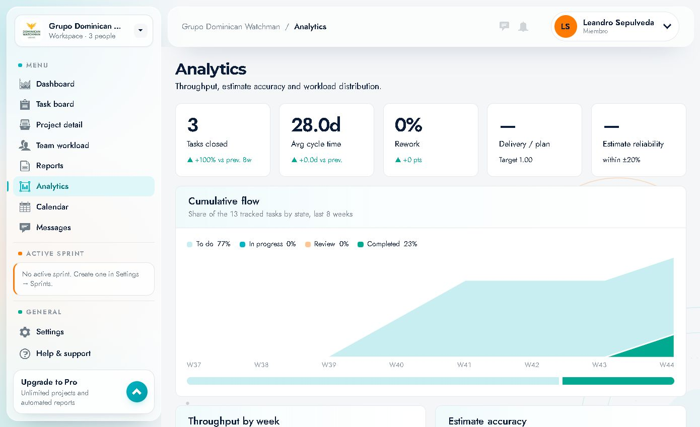
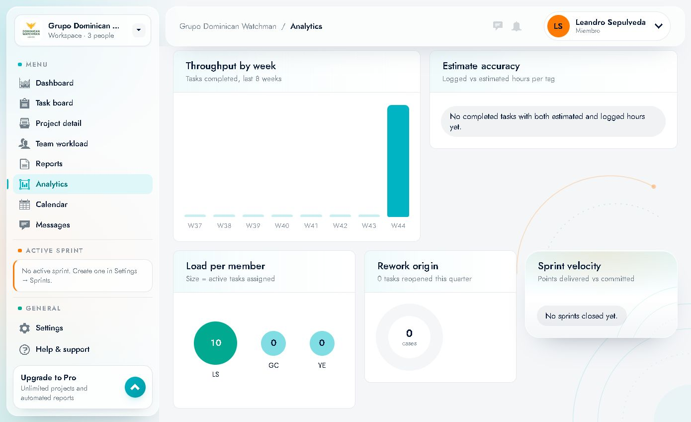

# 09 · Analytics

Route: `/analytics` · **"Analytics"** item in the menu.

It measures **delivery, quality and work distribution**. It is a read-only view, with no filters or actions.

---

## 1. Header

- Title **"Analytics"**.
- Subtitle: *"Throughput, estimate accuracy and workload distribution."*

---

## 2. KPI cards

| KPI | Example | Meaning |
|---|---|---|
| **Tasks closed** | `3` · `▲ +100% vs prev. 8w` | Tasks closed in the period and comparison with the previous 8 weeks |
| **Avg cycle time** | `28.0d` · `▲ +0.0d vs prev.` | Average time from when a task starts until it is closed |
| **Rework** | `0%` · `▲ +0 pts` | Proportion of work reopened/redone |
| **Delivery / plan** | `—` · `Target 1.00` | Plan compliance (1.00 = 100%) |
| **Estimate reliability** | `—` · `within ±20%` | Reliability of estimates (within ±20%) |

### How to interpret it
- **Tasks closed** goes up → good pace; if it goes down, review blockers and WIP.
- **Cycle time** high → work takes too long to flow (bottlenecks in Review, dependencies…).
- **Rework > 0** → rework; review quality and acceptance criteria.
- **Delivery / plan** and **Estimate reliability** require enough data; they appear as `—` when there is no base.

---

## 3. Cumulative flow

- Header: *"Share of the 13 tracked tasks by state, last 8 weeks"*.
- Legend: **To do 77%**, **In progress 0%**, **Review 0%**, **Completed 23%**.
- Cumulative area chart by week (`W37`…`W44`).
- Bottom bar with the proportion of each state.

**Use:** see how work accumulates. If *To do* grows without stopping, the backlog is inflating; if *Review* widens, there is a validation bottleneck.

---

## 4. Throughput by week

- *"Tasks completed, last 8 weeks"*.
- Bars by week (`W37`…`W44`).
- In the example, activity is concentrated in **W44**.

**Use:** compare weeks and spot delivery drops.

---

## 5. Estimate accuracy

- *"Logged vs estimated hours per tag"*.
- Compares logged hours with estimated hours grouped by tag.
- Empty state observed: **"No completed tasks with both estimated and logged hours yet."**

**Use:** when there is data, it allows calibrating estimates by type of work (Backend, Frontend, QA…).

---

## 6. Load per member

- *"Size = active tasks assigned"*.
- Bubbles per person: **LS 10**, **GC 0**, **YE 0**.
- The size represents the active load.

**Use:** spot load imbalance at a glance.

---

## 7. Rework origin

- *"0 tasks reopened this quarter"*.
- Donut with the number of cases.

**Use:** if it grows, identify which type of tasks are reopened (quality, changing requirements, bugs).

---

## 8. Sprint velocity

- *"Points delivered vs committed"*.
- Empty state observed: **"No sprints closed yet."**

**Use:** when there are closed sprints, it allows committing realistic points in planning.

---

## 9. How to use Analytics in practice

| Question | Metric |
|---|---|
| Are we delivering more or less? | Tasks closed, Throughput by week |
| Is work taking too long? | Avg cycle time |
| Where does it get stuck? | Cumulative flow (the column that grows) |
| Are we redoing work? | Rework, Rework origin |
| Do we estimate well? | Estimate reliability, Estimate accuracy |
| Is the load balanced? | Load per member + Team workload |
| Do we meet what we committed? | Delivery / plan, Sprint velocity |

---

## 10. Notes

- The default periods are the **last 8 weeks** (flow, throughput) and the **quarter** (rework).
- Without an active/closed sprint, several metrics appear empty or as `—`.
- The figures depend on tasks being moved between states correctly and on time being logged.
