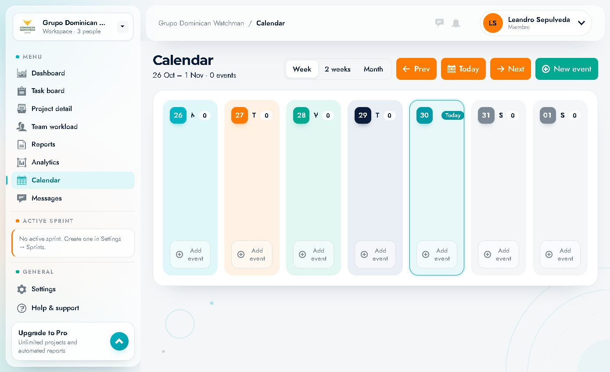
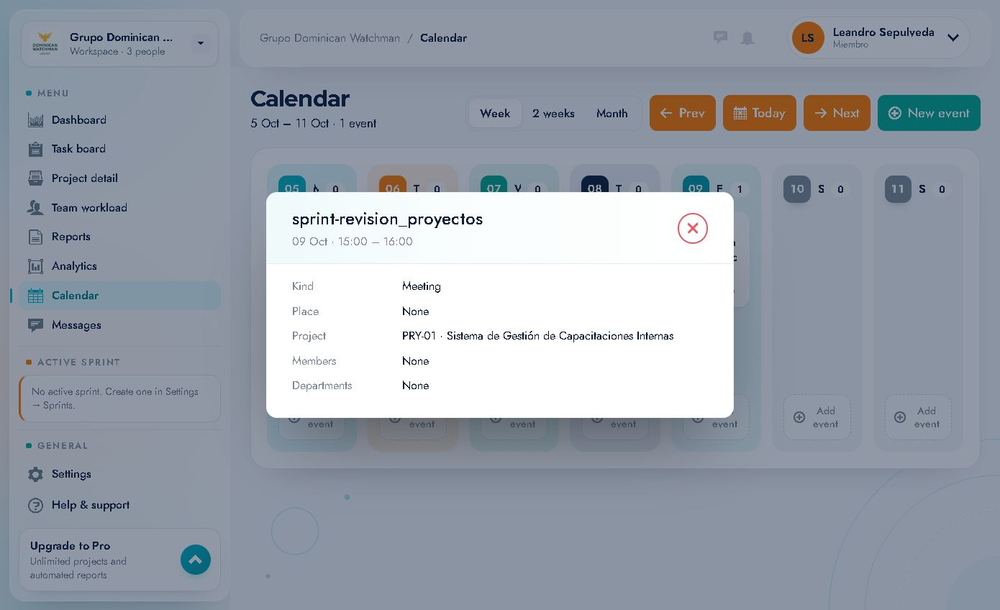

# 10 · Calendario (Calendar)

Ruta: `/calendar` · Elemento **"Calendar"** del menú.

Calendario compartido del espacio de trabajo: reuniones, revisiones, demos, deadlines y retros, vinculables a proyectos, personas y departamentos.

---

## 1. Encabezado

- Título **"Calendar"**.
- Rango visible y número de eventos: *"26 Oct – 1 Nov · 0 events"* (o *"1 event"*).
- Conmutador de vista: **Week** · **2 weeks** · **Month**.
- Navegación: **← Prev** · **Today** · **Next →**.
- Botón **"New event"**.

### Vistas
| Vista | Muestra |
|---|---|
| **Week** | 7 columnas (lun–dom) con los eventos de cada día |
| **2 weeks** | 14 columnas |
| **Month** | Rejilla mensual (p. ej. *October 2026*) con el número de eventos por día |

En **Month**, cada celda muestra el día y un contador; al pulsar un día se accede a su detalle/creación.

---

## 2. Celdas de día

Cada columna muestra:
- Número de día y abreviatura (`26 Mon`, `27 Tue`…).
- Chip **"Today"** en el día actual.
- Contador de eventos (`0`, `1`…).
- Los eventos como tarjetas con título y hora.
- Botón punteado **"+ Add event"** al pie.

Al pulsar **"+ Add event"** de un día se abre **New event** con la fecha precargada.

---

## 3. Eventos existentes

Ejemplo real del espacio: en la semana del **5–11 Oct** hay un evento:

- **sprint-revision_proyectos**
- **09 Oct · 15:00 – 16:00**
- Tipo: **Meeting**
- Proyecto: **PRY-01 · Sistema de Gestión de Capacitaciones Internas**
- Place: None · Members: None · Departments: None

### Ver el detalle
Pulsa la tarjeta del evento → modal con:
| Campo | Ejemplo |
|---|---|
| Título | sprint-revision_proyectos |
| Fecha y hora | 09 Oct · 15:00 – 16:00 |
| **Kind** | Meeting |
| **Place** | None |
| **Project** | PRY-01 · … |
| **Members** | None |
| **Departments** | None |

> En la cuenta documentada el modal es de **solo lectura** (no muestra editar/eliminar). La gestión completa depende de permisos.

---

## 4. Crear un evento

Botón **"New event"** (o **"+ Add event"** de un día).

### Formulario
| Campo | Tipo | Opciones / valores |
|---|---|---|
| **Title** | texto | Placeholder `Client demo` |
| **Date** | selector de día | Por defecto, hoy (`30.10.2026` en el ejemplo) |
| **Starts** | selector de hora | Por defecto `10:00` |
| **Ends** | selector de hora | Por defecto `11:00` |
| **Kind** | select | `Meeting`, `Review`, `Demo`, `Deadline`, `Retro`, `Other` |
| **Place / tool** | select | `No place` u opciones de lugar/herramienta |
| **Project** | select | `No project` o cualquier proyecto |
| **Members** | select múltiple | `Add a member…` |
| **Departments** | select múltiple | `Add a department…` |
| **Cancel / Add event** | botones | Descartar / crear |

### Paso a paso
1. Pulsa **"New event"** (o el **+ Add event** del día).
2. Escribe el **título**.
3. Confirma **fecha**, **hora de inicio** y **fin**.
4. Elige el **tipo** (Meeting, Review, Demo, Deadline, Retro, Other).
5. Indica **lugar o herramienta** (sala, Zoom, Meet…).
6. Vincula el **proyecto** si aplica.
7. Añade **miembros** y/o **departamentos** invitados.
8. Pulsa **"Add event"**.

> **Consejo:** usa `Deadline` para hitos de entrega y `Review`/`Demo` para ceremonias; así el calendario comunica el plan además de las reuniones.

---

## 5. Navegación temporal

- **← Prev / Next →**: avanza o retrocede según la vista (semana, 2 semanas o mes).
- **Today**: vuelve a la fecha actual.
- El rango se muestra siempre en el subtítulo.
- En **Month** se ven los días de los meses adyacentes con contador.

---

## 6. Integración con proyectos

- La pestaña **Calendar** del proyecto lista solo sus eventos y ofrece **"Open calendar"**.
- Al crear un evento puedes vincularlo a un proyecto, y aparecerá en ambos sitios.
- Los eventos con **Members** o **Departments** se muestran a esas personas.

---

## 7. Casos de uso

| Necesidad | Configuración sugerida |
|---|---|
| Daily / weekly | `Meeting`, recurrencia manual, miembros del equipo |
| Revisión de sprint | `Review`, proyecto, día de cierre |
| Demo al cliente | `Demo`, proyecto, lugar/herramienta |
| Fecha de entrega | `Deadline`, proyecto, sin hora o al final del día |
| Retrospectiva | `Retro`, equipo/departamento |
| Bloqueo de agenda | `Other` + título descriptivo |

---

## 8. Notas

- El calendario global muestra **0 eventos** en la semana actual del ejemplo; el evento de octubre aparece al navegar a esa semana.
- Si un evento no aparece, revisa el rango de fechas y los filtros de proyecto/miembros del evento.
- Los eventos sin miembros ni departamentos son visibles para quien tenga acceso al proyecto/espacio.
