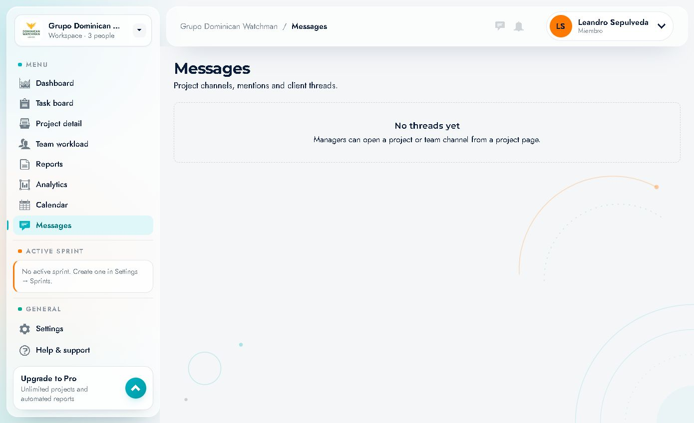

# 11 · Messages

Route: `/messages` · Chat icon in the header or **"Messages"** item in the menu.

It brings together **project and team channels**, mentions and client threads.

---

## 1. What it shows

- Title **"Messages"**.
- Subtitle: *"Project channels, mentions and client threads."*

### Empty state
When there are no threads:

> **"No threads yet"**
> *"Managers can open a project or team channel from a project page."*

This indicates:
1. There are no open conversations in the workspace.
2. Channels are created by **managers/administrators** from a project page.

---

## 2. How it is used (according to the app)

### As a member
- Here you will see the threads you take part in and the mentions.
- You can read and reply within each thread.
- Mention notifications arrive at the header **bell**.

### As a manager/administrator
1. Open a **project**.
2. Create/open the **project** or team **channel**.
3. The channel appears in **Messages** for the participants.
4. Invite members of the project or the department.

> In the documented account (role **Member**) the inbox is empty and no creation button is offered, consistent with the message on the screen.

---

## 3. Relationship with notifications

| Event | Where it is seen |
|---|---|
| Mention in a thread | Bell (red counter) + Messages |
| New message in a channel | Counter on the chat/bell icon |
| Task activity | Bell → Recent activity |

See [13 · Notifications](13-notificaciones-y-menu.md).

---

## 4. Best practices

- **One channel per project**: avoids mixing contexts.
- **Team channel** for announcements that affect everyone.
- **Mention** the specific person when you need action.
- **Summarise decisions** in the task or in Documents, not only in the chat.
- **Do not share credentials** or sensitive data over chat.

---

## 5. Observed limitations

- Without threads, there is no visible search or filters.
- Channel creation is not exposed to the Member role.
- The header icon opens this same screen.
