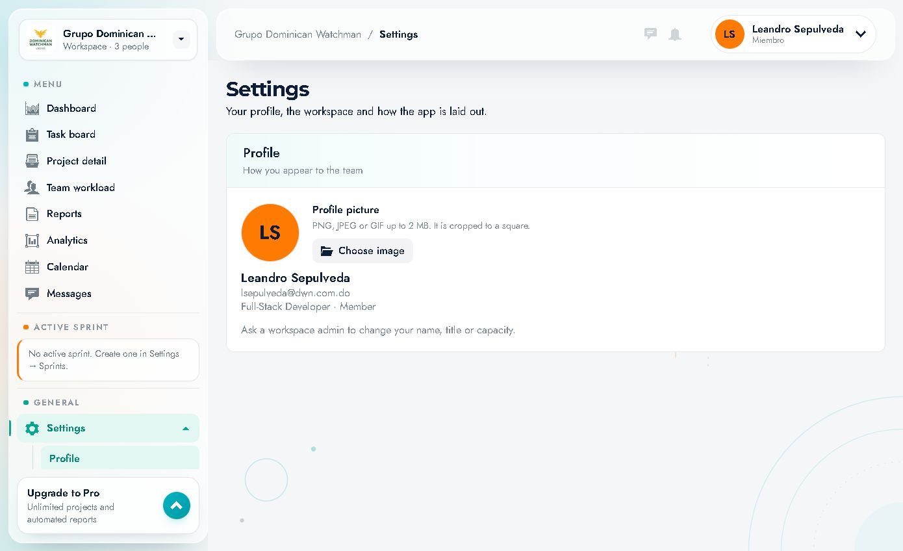
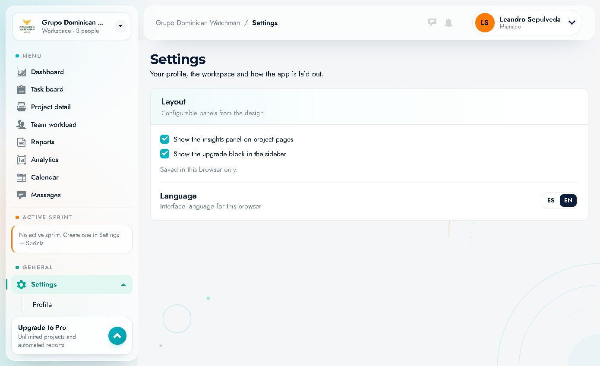
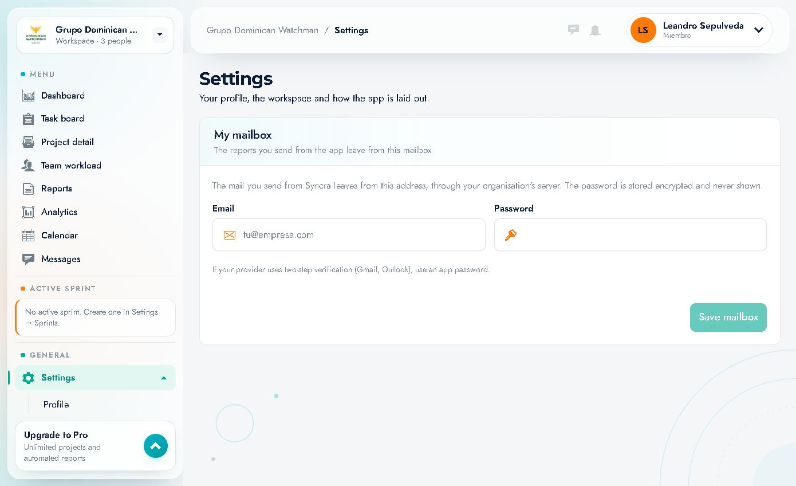

# 12 · Configuración y perfil (Settings)

Ruta: `/settings` · Menú lateral **Settings**.

La configuración se divide en secciones que se abren en el submenú de la izquierda y se reflejan en la URL (`?section=profile|preferences|mailbox`).

Secciones disponibles para el rol **Member**:

1. **Profile**
2. **Preferences**
3. **My mailbox**

> El espacio muestra además referencias a *Settings → Sprints* (para crear sprints), pero esa sección **no aparece** con el rol Member; la gestiona un administrador.

---

## 1. Profile

Ruta: `/settings?section=profile`

### Qué contiene
- **Profile picture**
  - Formatos: **PNG, JPEG o GIF**.
  - Tamaño máximo: **2 MB**.
  - Se recorta a un **cuadrado**.
  - Botón **"Choose image"** para subir/cambiar la foto.
- **Nombre**: Leandro Sepulveda.
- **Email**: `lsepulveda@dwn.com.do`.
- **Puesto y rol**: `Full-Stack Developer · Member`.
- Nota: *"Ask a workspace admin to change your name, title or capacity."*

### Cambiar la foto
1. Pulsa **"Choose image"**.
2. Selecciona un archivo PNG/JPEG/GIF de hasta 2 MB.
3. Ajusta el recorte cuadrado si la app lo solicita.
4. Guarda. La nueva imagen aparece en la cabecera, tarjetas y tablas.

### Qué no puedes cambiar tú
- **Nombre**, **puesto** y **capacidad**: los modifica un administrador del espacio.
- **Email**: ligado a la cuenta; gestión por administrador.

---

## 2. Preferences

Ruta: `/settings?section=preferences`

### Layout (paneles configurables)
Dos casillas:

| Opción | Efecto |
|---|---|
| **"Show the insights panel on project pages"** | Muestra/oculta el panel de insights en las páginas de proyecto |
| **"Show the upgrade block in the sidebar"** | Muestra/oculta la tarjeta **Upgrade to Pro** en la barra lateral |

> **"Saved in this browser only."** → estas preferencias son locales del navegador; no afectan a otros usuarios ni a otros dispositivos.

### Language
- **"Interface language for this browser"**.
- Botones **ES** / **EN**.
- Cambia los textos de la interfaz en este navegador.

### Cómo usarlas
1. Entra en **Settings → Preferences**.
2. Marca/desmarca las casillas según tu espacio de trabajo ideal.
3. Elige **ES** o **EN**.
4. Los cambios se aplican al instante y se guardan en el navegador.

---

## 3. My mailbox

Ruta: `/settings?section=mailbox`

Sirve para que **los reportes que envías desde la app salgan desde tu propio buzón**.

### Texto de la pantalla
> *"The mail you send from Syncra leaves from this address, through your organisation's server. The password is stored encrypted and never shown."*

### Campos
| Campo | Descripción |
|---|---|
| **Email** | Dirección desde la que saldrán los envíos |
| **Password** | Contraseña o **app password** del buzón |
| **Save mailbox** | Guarda la configuración |

### Nota importante
> *"If your provider uses two-step verification (Gmail, Outlook), use an app password."*

Si tu proveedor tiene verificación en dos pasos, **genera una contraseña de aplicación** y pégala aquí; no uses tu contraseña normal.

### Cómo configurarlo
1. Abre **Settings → My mailbox**.
2. Escribe el **email** desde el que quieres enviar.
3. Escribe la **contraseña de aplicación**.
4. Pulsa **"Save mailbox"**.
5. Envía un reporte de prueba para confirmar.

### Seguridad
- La contraseña se guarda **cifrada** y **nunca se muestra**.
- Si cambias la contraseña del correo, actualízala aquí.
- Si el envío falla, revisa: servidor SMTP de la organización, contraseña de aplicación, y que el buzón permita envío.

---

## 4. Secciones de administración (no visibles para Member)

La app menciona estas capacidades en distintos lugares; pertenecen a administradores:

| Sección | Dónde se menciona | Para qué sirve |
|---|---|---|
| **Sprints** | Tarjeta *Active sprint*: *"Create one in Settings → Sprints"* | Crear/cerrar sprints, capacidad, compromiso de puntos |
| **Members / equipo** | *"Ask a workspace admin to change your name, title or capacity"* | Altas, roles, puestos, capacidad |
| **Projects** | *"Manage the portfolio: create, edit, archive…"* | Alta/edición/archivo de proyectos |
| **Billing / Pro** | Tarjeta *Upgrade to Pro* | Plan y facturación |

Si necesitas alguna de estas acciones, contacta con un administrador (en este espacio, **Gerson Cabreja**).

---

## 5. Resumen rápido

| Quiero… | Voy a… |
|---|---|
| Cambiar mi foto | Settings → Profile → Choose image |
| Ocultar el bloque de upgrade | Settings → Preferences |
| Ocultar insights en proyectos | Settings → Preferences |
| Cambiar idioma | Menú de usuario o Settings → Preferences → ES/EN |
| Enviar reportes desde mi correo | Settings → My mailbox |
| Cambiar mi nombre/puesto | Pedirlo a un administrador |
