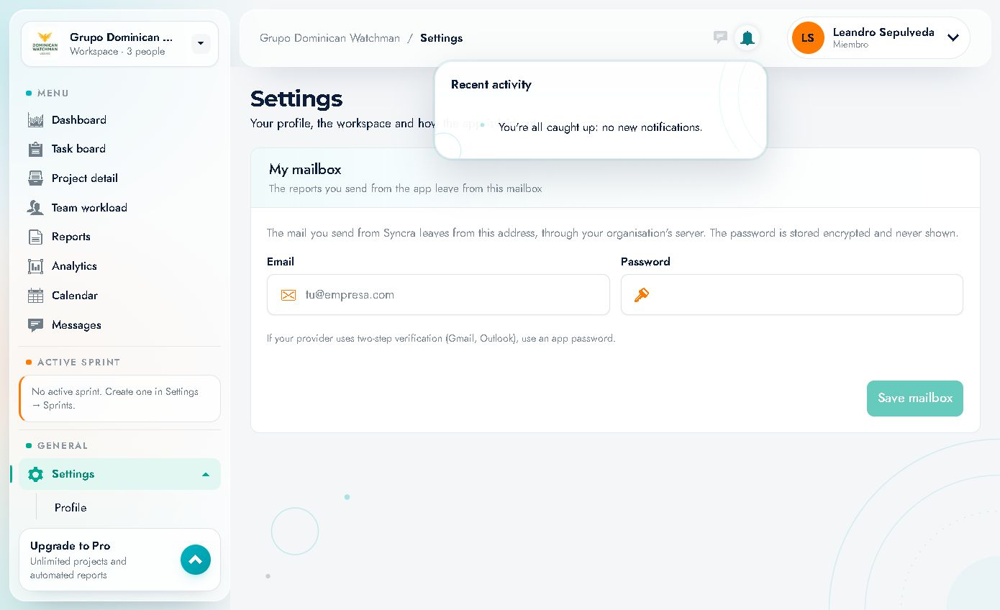
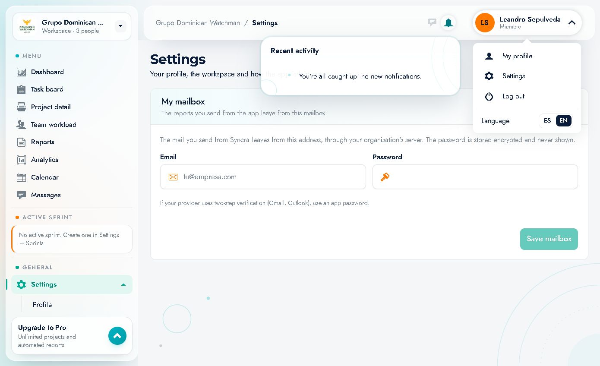

# 13 · Notificaciones y menú de usuario

Todo lo que hay en la esquina superior derecha de la cabecera.

---

## 1. Campana de notificaciones

Botón con forma de campana y un **contador rojo** con las notificaciones no leídas (en la captura inicial, `4`).

### Panel "Recent activity"
Al pulsar la campana se abre un panel desplegable:

- Título **"Recent activity"**.
- Chip **"4 new"** con las no leídas.
- Lista de actividades, cada una con:
  - Icono según el tipo (tarea, check, etc.).
  - Texto de la acción, p. ej. *Task "Backend núcleo [1]" moved to In review*.
  - Autor (*Gerson Cabreja*).
  - Fecha (*28 Oct*).
  - Punto azul a la izquierda si es nueva.

### Ejemplos observados
- Task "Backend núcleo [1]" moved to In review — Gerson Cabreja · 28 Oct
- Task "Análisis y diseño" marked done — Gerson Cabreja · 28 Oct
- Task "Wireframes y validación con RRHH" marked done — Gerson Cabreja · 28 Oct
- Task "Modelo de datos, reglas y contrato de API" marked done — Gerson Cabreja · 28 Oct

### Comportamiento importante
- **Abrir el panel marca las notificaciones como leídas**: el contador desaparece y el panel pasa a mostrar:
  > **"You're all caught up: no new notifications."**

  Por eso, si abres la campana "un segundo", ya no verás el contador. Es el comportamiento normal.
- Las notificaciones se generan por actividad de tareas y menciones.
- El panel se cierra al hacer clic fuera.

### Buen uso
- Revísalo al empezar el día y antes de la daily.
- Si algo requiere acción, ve a la tarea/proyecto y resuélvelo; la campana no es una bandeja de tareas.

---

## 2. Icono de mensajes

Globo de chat a la izquierda de la campana.

- Abre directamente **Messages** (`/messages`).
- Puede mostrar contador cuando hay mensajes sin leer (no visible en el estado vacío actual).

Ver [11 · Mensajes](11-mensajes.md).

---

## 3. Menú de usuario

Pulsa el chip con tu **avatar + nombre + rol**.

| Opción | Acción |
|---|---|
| **My profile** | Abre *Settings → Profile* |
| **Settings** | Abre *Settings* |
| **Log out** | Cierra la sesión y vuelve a `/login` |
| **Language** | Conmutador **ES / EN** para este navegador |

El chip muestra:
- Iniciales en un círculo de color (o la foto si la has subido).
- Nombre completo.
- Rol en el espacio (`Miembro` / `Member`).
- Una flecha que indica que se despliega.

---

## 4. Cerrar sesión correctamente

1. Pulsa tu nombre/avatar.
2. Elige **"Log out"**.
3. Serás redirigido a la pantalla de login.
4. Si usabas un equipo compartido, no marques **"Keep me signed in"** la próxima vez.

---

## 5. Diferencias entre campana y mensajes

| | Campana | Mensajes |
|---|---|---|
| Contenido | Actividad de tareas/proyectos y menciones | Hilos y canales |
| Acción | Informativa (te lleva al contexto) | Conversación |
| Contador | No leídas | No leídos |
| Marca como leído | Al abrir el panel | Al abrir el hilo |
